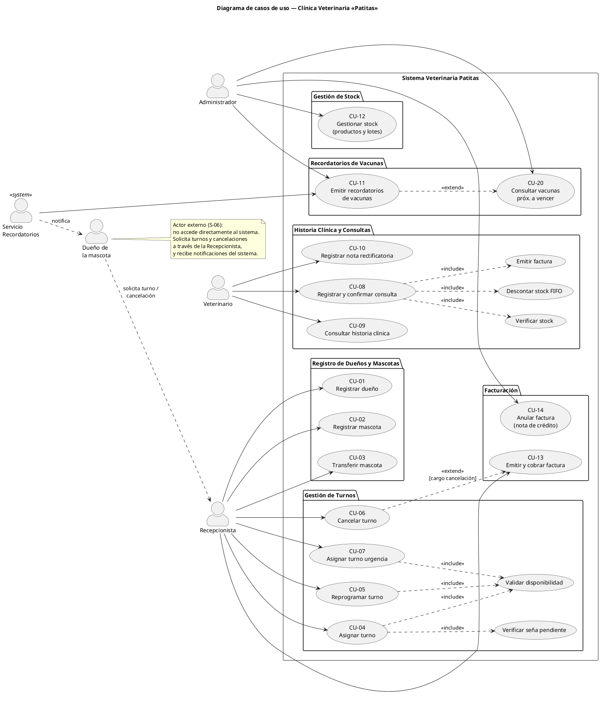

# 2. Casos de uso — Sistema Clínica Veterinaria «Patitas»

Fuentes en `uml/casos-de-uso/`.

---

## Módulo 1 — Registro de dueños y mascotas

### CU-01: Registrar dueño

| Campo | Descripción |
|---|---|
| **Actor principal** | Recepcionista |
| **Precondición** | El actor ha iniciado sesión con rol Recepcionista. El documento del dueño no existe previamente en el sistema. |
| **Postcondición** | Se registra el dueño en el sistema sin ausencias acumuladas ni señas pendientes. |

**Flujo principal:**

1. La recepcionista selecciona la opción «Registrar nuevo dueño».
2. El sistema presenta el formulario de alta de dueño.
3. La recepcionista ingresa: nombre, apellido, número de documento, teléfono de contacto y correo electrónico.
4. El sistema valida que el documento no esté registrado previamente.
5. El sistema valida que el correo electrónico tenga formato válido.
6. El sistema registra los datos del dueño y los almacena.
7. El sistema muestra el mensaje «Dueño registrado correctamente» con los datos asignados.

**Flujos alternativos / de error:**

- **FA-01a — Documento ya registrado (paso 4):** el sistema muestra «Ya existe un dueño registrado con ese documento» y regresa al formulario sin crear el registro.
- **FA-01b — Correo con formato inválido (paso 5):** el sistema informa el error de formato y solicita corrección.
- **FA-01c — Campos obligatorios vacíos (paso 3):** el sistema resalta los campos faltantes y no avanza hasta completarlos.

---

### CU-02: Registrar mascota

| Campo | Descripción |
|---|---|
| **Actor principal** | Recepcionista |
| **Precondición** | El dueño está registrado en el sistema (RF-01). El actor tiene rol Recepcionista. |
| **Postcondición** | Se registra la mascota según su especie asociada a su dueño responsable, iniciando su historia clínica. |

**Flujo principal:**

1. La recepcionista busca al dueño por documento o nombre.
2. El sistema muestra el perfil del dueño con su lista de mascotas.
3. La recepcionista selecciona «Agregar mascota».
4. El sistema presenta el formulario de alta de mascota: nombre, especie, raza, sexo, fecha de nacimiento, peso inicial.
5. La recepcionista selecciona la especie (perro, gato, ave o conejo).
6. El sistema muestra los campos específicos de la especie seleccionada:
   - **Perro:** número de chip y tamaño (pequeño, mediano, grande).
   - **Gato:** indicador «vive en interior» (sí/no).
   - **Ave:** indicador «puede volar» (sí/no).
   - **Conejo:** tipo de pelaje (corto, largo).
7. La recepcionista completa los datos y confirma.
8. El sistema guarda la mascota, la asocia al dueño e inicializa su historia clínica.
9. El sistema muestra el mensaje «Mascota registrada correctamente».

**Flujos alternativos / de error:**

- **FA-02a — Dueño no encontrado (paso 1):** el sistema informa que no existe el dueño y ofrece la opción de registrarlo (redirige a CU-01).
- **FA-02b — Especie no contemplada (paso 5):** el sistema solo presenta las especies soportadas por la clínica.
- **FA-02c — Fecha de nacimiento futura (paso 7):** el sistema rechaza la fecha y solicita corrección.
- **FA-02d — Peso inicial no positivo:** el sistema informa que el peso debe ser mayor que cero.

---

### CU-03: Transferir mascota

| Campo | Descripción |
|---|---|
| **Actor principal** | Recepcionista |
| **Precondición** | La mascota y ambos dueños (cedente y receptor) existen en el sistema. |
| **Postcondición** | La mascota queda asociada al nuevo dueño. La historia clínica se conserva íntegramente. |

**Flujo principal:**

1. La recepcionista busca la mascota por nombre o identificador.
2. El sistema muestra la ficha de la mascota con su dueño actual.
3. La recepcionista selecciona «Transferir mascota».
4. El sistema solicita el documento del nuevo dueño.
5. La recepcionista ingresa el documento del nuevo dueño.
6. El sistema localiza al nuevo dueño y muestra su nombre para confirmación.
7. La recepcionista confirma la transferencia.
8. El sistema actualiza la vinculación de la mascota asignándole el nuevo dueño responsable, conservando intacta su historia clínica acumulada.
9. El sistema registra la fecha y los involucrados en un evento de auditoría de la transferencia.
10. El sistema informa «Mascota transferida correctamente».

**Flujos alternativos / de error:**

- **FA-03a — Nuevo dueño no registrado (paso 6):** el sistema informa que el documento no corresponde a ningún dueño registrado y ofrece registrarlo primero.
- **FA-03b — Nuevo dueño igual al actual:** el sistema informa que la mascota ya pertenece a ese dueño y cancela la operación.

---

## Módulo 2 — Gestión de turnos

### CU-04: Asignar turno

| Campo | Descripción |
|---|---|
| **Actor principal** | Recepcionista |
| **Precondición** | La mascota y el veterinario existen en el sistema. El actor tiene rol Recepcionista. |
| **Postcondición** | Se registra un turno en estado programado asociado a la mascota y al veterinario, dentro de su horario de atención y sin superposición. |

**Flujo principal:**

1. La recepcionista selecciona «Nuevo turno».
2. Ingresa el identificador de la mascota, la matrícula del veterinario, la fecha y hora deseada y el tipo de atención (consulta general, vacunación o cirugía).
3. El sistema determina la duración según el tipo de atención: consulta general 30 minutos, vacunación 15 minutos, cirugía 120 minutos.
4. El sistema verifica si el dueño de la mascota adeuda una seña por ausencias previas.
5. El sistema verifica que la fecha y hora propuestas se encuentren dentro del horario de atención configurado para el veterinario.
6. El sistema verifica que no exista superposición de horarios con otros turnos ya agendados para ese veterinario.
7. El sistema registra el nuevo turno en estado programado en la agenda del veterinario.
8. El sistema confirma el turno a la recepcionista con fecha, hora y número de turno asignado.

**Flujos alternativos / de error:**

- **FA-04a — Seña pendiente (paso 4):** el sistema advierte que el dueño adeuda una seña por registrar tres ausencias consecutivas; la recepcionista debe registrar el cobro de la seña antes de confirmar el turno.
- **FA-04b — Fuera del horario del veterinario (paso 5):** el sistema advierte que el horario está fuera de la franja de atención del veterinario e informa su disponibilidad horaria.
- **FA-04c — Superposición de turno (paso 6):** el sistema informa que el profesional ya tiene un turno asignado en ese horario y sugiere los próximos horarios libres.

---

### CU-05: Reprogramar turno

| Campo | Descripción |
|---|---|
| **Actor principal** | Recepcionista |
| **Precondición** | El turno existe en estado programado. La nueva fecha y hora está disponible en la agenda del mismo veterinario. |
| **Postcondición** | El turno actualiza su fecha y hora manteniendo su estado programado. Se registra la reprogramación. |

**Flujo principal:**

1. La recepcionista busca el turno por número o por mascota.
2. El sistema muestra los datos actuales del turno.
3. La recepcionista selecciona «Reprogramar» e ingresa la nueva fecha y hora.
4. El sistema aplica las mismas validaciones de disponibilidad que en CU-04: horario de atención y verificación de superposiciones.
5. El sistema actualiza la fecha y hora del turno existente.
6. El sistema informa que la reprogramación fue exitosa.

**Flujos alternativos / de error:**

- **FA-05a — Turno ya atendido o cancelado:** el sistema informa que el turno no puede reprogramarse y cancela la operación.
- **FA-05b — Nuevo horario no disponible:** ídem FA-04b / FA-04c.

---

### CU-06: Cancelar turno

| Campo | Descripción |
|---|---|
| **Actor principal** | Recepcionista |
| **Precondición** | El turno existe en estado programado. |
| **Postcondición** | El turno queda en estado cancelado. Si se cancela con menos de 2 horas de anticipación, se registra un cargo equivalente al 20 % de la atención. |

**Flujo principal:**

1. La recepcionista busca el turno y selecciona «Cancelar turno».
2. El sistema calcula el tiempo restante hasta la hora del turno.
3. Si el tiempo restante es mayor o igual a 2 horas: se cancela sin cargo.
4. Si el tiempo restante es menor a 2 horas: el sistema informa que se aplicará un cargo del 20 % del arancel correspondiente al tipo de atención y solicita confirmación.
5. La recepcionista confirma.
6. El sistema cambia el estado del turno a cancelado y, si corresponde, registra el cargo pendiente al dueño.
7. El sistema informa la cancelación.

**Flujos alternativos / de error:**

- **FA-06a — Recepcionista no confirma el cargo:** se cancela la operación; el turno permanece programado.
- **FA-06b — Turno ya cancelado o atendido:** el sistema informa que la operación no es aplicable.

---

### CU-07: Asignar turno de urgencia

| Campo | Descripción |
|---|---|
| **Actor principal** | Recepcionista |
| **Precondición** | Existe un veterinario de guardia designado para el día actual por el Administrador. La mascota está registrada. |
| **Postcondición** | Se registra un turno de urgencia con duración de 30 minutos en el primer espacio disponible del veterinario de guardia a partir del momento actual. Si ocupa el horario previo a un turno programado, este último se desplaza solo una posición. |

**Flujo principal:**

1. La recepcionista selecciona «Turno de urgencia».
2. El sistema identifica al veterinario de guardia del día.
3. El sistema busca el primer espacio libre a partir del momento actual en la agenda del veterinario de guardia.
4. Si el turno de urgencia (30 min) se ubica inmediatamente antes de un turno programado existente, ese turno se desplaza 30 min hacia adelante, siempre que no supere el horario de atención del veterinario. El desplazamiento no se propaga en cadena.
5. El sistema registra el turno con carácter de urgencia, lo asigna a la agenda y confirma a la recepcionista.

**Flujos alternativos / de error:**

- **FA-07a — Sin veterinario de guardia asignado:** el sistema informa que no hay guardia designada para hoy y sugiere contactar al administrador.
- **FA-07b — Sin hueco disponible en la guardia:** el sistema informa que la agenda del veterinario de guardia está completa y no es posible asignar la urgencia.
- **FA-07c — Desplazamiento dejaría turno fuera de horario:** el sistema no desplaza el turno existente e informa la situación; la recepcionista decide manualmente.

---

## Módulo 3 — Historia clínica y consultas

### CU-08: Registrar consulta y confirmarla

| Campo | Descripción |
|---|---|
| **Actor principal** | Veterinario |
| **Precondición** | El turno existe en estado programado. El actor tiene rol con permiso de registrar consultas (Veterinario). |
| **Postcondición** | La consulta queda en estado confirmada. Se descuenta el stock consumido, el turno pasa a estado atendido, la consulta se incorpora a la historia clínica de la mascota (inmutable) y se genera la factura correspondiente. |

**Flujo principal:**

1. El veterinario selecciona el turno programado.
2. El sistema inicia una consulta en estado borrador asociada al turno.
3. El veterinario registra el motivo de la consulta y el peso del día de la mascota.
4. El veterinario registra el diagnóstico y las observaciones clínicas.
5. Opcionalmente el veterinario agrega tratamientos: para cada uno selecciona el medicamento del catálogo e ingresa dosis, frecuencia y duración. El sistema valida que se haya registrado previamente el peso del día (RF-13).
6. Opcionalmente el veterinario aplica vacunas: selecciona la vacuna del catálogo e indica el lote. El sistema valida la edad mínima requerida de la mascota y calcula la fecha del próximo refuerzo.
7. El veterinario selecciona «Confirmar consulta».
8. El sistema verifica que haya disponibilidad de stock suficiente para cada medicamento indicado en los tratamientos.
9. El sistema descuenta el stock de cada insumo utilizado consumiendo prioritariamente los lotes no vencidos con fecha de vencimiento más próxima (criterio FIFO).
10. El sistema actualiza el estado del turno a atendido.
11. El sistema incorpora la consulta confirmada a la historia clínica de la mascota de manera permanente e inmutable.
12. El sistema emite la factura correspondiente por la consulta y los medicamentos administrados.
13. El sistema confirma al veterinario que la consulta fue registrada y la factura emitida.

**Flujos alternativos / de error:**

- **FA-08a — Sin stock disponible (paso 8):** el sistema alerta sobre la falta de stock del producto solicitado; no realiza ningún descuento ni cambio permanente, el turno permanece programado y la consulta continúa en borrador. El veterinario puede modificar el tratamiento o posponer la confirmación.
- **FA-08b — Lote vencido detectado (paso 9):** el sistema omite el lote vencido y utiliza el siguiente lote vigente en orden FIFO. Si no hay lotes vigentes con stock suficiente, aplica FA-08a.
- **FA-08c — Mascota menor a la edad mínima para la vacuna (paso 6):** el sistema advierte que la mascota no cumple con la edad mínima requerida para la vacuna y no permite su aplicación.
- **FA-08d — Sin peso del día al intentar agregar tratamiento (paso 5):** el sistema informa que el registro del peso es obligatorio antes de indicar medicamentos cuya dosificación depende de él.

---

### CU-09: Consultar historia clínica

| Campo | Descripción |
|---|---|
| **Actor principal** | Veterinario |
| **Precondición** | La mascota tiene al menos una consulta confirmada registrada. |
| **Postcondición** | Sin cambios en el sistema (operación de solo lectura). |

**Flujo principal:**

1. El veterinario busca la mascota por nombre o identificador.
2. El sistema muestra la ficha de la mascota.
3. El veterinario selecciona «Ver historia clínica».
4. El sistema recupera y muestra el historial de consultas de la historia clínica de la mascota en orden cronológico, con sus diagnósticos, tratamientos, vacunas aplicadas y notas rectificatorias asociadas.
5. El veterinario puede expandir cada entrada para examinar el detalle completo de la atención.

**Flujos alternativos / de error:**

- **FA-09a — Historia clínica vacía:** el sistema informa que la mascota no posee consultas registradas aún.

---

### CU-10: Registrar nota rectificatoria

| Campo | Descripción |
|---|---|
| **Actor principal** | Veterinario |
| **Precondición** | La consulta a rectificar existe en estado confirmada. El veterinario firmante tiene matrícula habilitada. |
| **Postcondición** | Se registra una nota rectificatoria vinculada a la consulta original. La consulta original no se modifica. |

**Flujo principal:**

1. El veterinario selecciona la consulta confirmada que desea rectificar.
2. El veterinario selecciona «Agregar nota rectificatoria».
3. El veterinario redacta el texto aclaratorio correspondiente.
4. El sistema registra la nota rectificatoria con la referencia a la consulta, el texto, la fecha actual y la matrícula del profesional firmante.
5. El sistema vincula la nota a la consulta original y la almacena.
6. El sistema confirma «Nota rectificatoria registrada correctamente».

**Flujos alternativos / de error:**

- **FA-10a — Texto vacío:** el sistema no permite guardar la nota y solicita ingresar el texto aclaratorio.

---

## Módulo 4 — Vacunas y recordatorios

### CU-11: Emitir recordatorios de vacunas

| Campo | Descripción |
|---|---|
| **Actor principal** | Proceso automático del sistema / Administrador (para consulta manual) |
| **Precondición** | Existen vacunas aplicadas registradas en el sistema con fecha de refuerzo calculada. |
| **Postcondición** | Se emiten notificaciones (simuladas por consola y archivo de log) a los dueños cuyas mascotas tienen vacunas con refuerzo próximo en los siguientes 7 días. Las vacunas cuyo refuerzo lleva más de 30 días transcurridos se consideran vencidas. |

**Flujo principal:**

1. El proceso de recordatorios se ejecuta (automáticamente de forma periódica o a solicitud del Administrador).
2. El sistema examina las vacunas aplicadas que se encuentran activas y pendientes de refuerzo.
3. Para cada vacuna: calcula los días restantes hasta la fecha de próximo refuerzo calculada.
4. Si faltan entre 1 y 7 días: genera un recordatorio avisando la proximidad del refuerzo para el dueño de la mascota.
5. Si la fecha ya pasó y transcurrieron hasta 30 días: emite un aviso de vencimiento reciente.
6. Si transcurrieron más de 30 días sin aplicar el refuerzo: clasifica la vacuna como vencida.
7. Las notificaciones se presentan simuladas por consola y se registran en el archivo de eventos.
8. El Administrador puede consultar el listado resultante en cualquier momento (RF-20).

**Flujos alternativos / de error:**

- **FA-11a — Sin vacunas próximas:** el sistema informa que no existen recordatorios pendientes para el período analizado.

---

## Módulo 5 — Stock de medicamentos e insumos

### CU-12: Gestionar stock

| Campo | Descripción |
|---|---|
| **Actor principal** | Administrador |
| **Precondición** | El actor tiene rol Administrador. |
| **Postcondición** | El producto o lote queda registrado en el sistema. Las alertas de reposición son visibles si el stock alcanza el mínimo. |

**Flujo principal — Registrar producto:**

1. El Administrador selecciona «Gestión de stock > Nuevo producto».
2. Ingresa: código, nombre, stock mínimo y proveedor.
3. El sistema registra el nuevo producto con su stock inicial en cero.
4. El sistema confirma el alta del producto.

**Flujo principal — Registrar lote:**

1. El Administrador selecciona un producto existente.
2. Selecciona «Agregar lote» e ingresa: cantidad y fecha de vencimiento.
3. El sistema registra el lote con su cantidad y fecha de vencimiento, incorporándolo al inventario ordenado por fecha de vencimiento (criterio FIFO).
4. El sistema recalcula el stock disponible total del producto.
5. Si el stock total resulta menor o igual al stock mínimo configurado, el sistema genera una alerta de reposición (RF-23).
6. El sistema confirma el ingreso del lote.

**Flujo principal — Consultar productos con stock bajo:**

1. El Administrador selecciona «Consultar stock bajo».
2. El sistema filtra los productos cuyo stock disponible es menor o igual a su stock mínimo.
3. El sistema muestra la lista con: código, nombre, stock actual, stock mínimo y el lote con vencimiento más próximo.

**Flujos alternativos / de error:**

- **FA-12a — Código de producto duplicado:** el sistema informa que ya existe un producto registrado con ese código.
- **FA-12b — Fecha de vencimiento ya pasada al registrar lote:** el sistema advierte que el lote ya se encuentra vencido al momento del ingreso y solicita corrección.

---

## Módulo 6 — Facturación

### CU-13: Emitir y cobrar factura

| Campo | Descripción |
|---|---|
| **Actor principal** | Recepcionista |
| **Precondición** | La consulta médica acaba de confirmarse (la factura se genera automáticamente al confirmar la atención). El actor tiene rol Recepcionista. |
| **Postcondición** | La factura queda registrada en estado emitida con el monto final calculado según el medio de pago y los descuentos o recargos correspondientes. |

**Flujo principal:**

1. Al confirmarse la consulta médica (CU-08, paso 12), el sistema genera el borrador de la factura con el detalle de la consulta y los insumos utilizados.
2. La recepcionista selecciona el medio de pago: efectivo, débito o crédito en cuotas.
3. El sistema calcula el subtotal sumando los ítems de servicios y productos consumidos.
4. El sistema determina el descuento aplicable: el mayor entre (a) 10 % si el medio de pago es efectivo, o (b) 15 % si el dueño posee plan de salud animal activo (no se acumulan).
5. El sistema aplica el descuento seleccionado sobre el subtotal.
6. Si el medio de pago es crédito en cuotas, el sistema añade un recargo del 8 % sobre el monto ya descontado.
7. El sistema calcula el importe total definitivo y lo presenta a la recepcionista.
8. La recepcionista confirma el cobro.
9. El sistema registra el pago, marca la factura en estado emitida y actualiza su registro.
10. El sistema emite el comprobante de facturación.

**Flujos alternativos / de error:**

- **FA-13a — Dueño con plan de salud y pago en efectivo:** el sistema aplica el 15 % (mayor descuento) en lugar del 10 %, e informa el criterio seleccionado.
- **FA-13b — Dueño con plan de salud y pago con crédito:** el sistema aplica el 15 % de descuento y luego calcula el 8 % de recargo sobre el importe resultante con descuento.

---

### CU-14: Anular factura (nota de crédito)

| Campo | Descripción |
|---|---|
| **Actor principal** | Administrador |
| **Precondición** | La factura existe en estado emitida. El actor tiene rol Administrador. |
| **Postcondición** | La factura pasa a estado anulada. Se registra una nota de crédito vinculada a ella. |

**Flujo principal:**

1. El Administrador busca la factura por número de comprobante.
2. El sistema muestra el detalle de la factura emitida.
3. El Administrador selecciona «Anular factura» e ingresa el motivo de la anulación.
4. El sistema genera la nota de crédito con la referencia a la factura, la fecha actual y el motivo informado.
5. El sistema cambia el estado de la factura a anulada.
6. El sistema emite la nota de crédito como comprobante de anulación.
7. El sistema confirma la anulación de la factura.

**Flujos alternativos / de error:**

- **FA-14a — Factura ya anulada:** el sistema informa que la factura ya fue anulada previamente y muestra la nota de crédito asociada.
- **FA-14b — Motivo vacío:** el sistema no permite continuar sin haber registrado un motivo formal de anulación.

---

## Diagrama de casos de uso (PlantUML)

