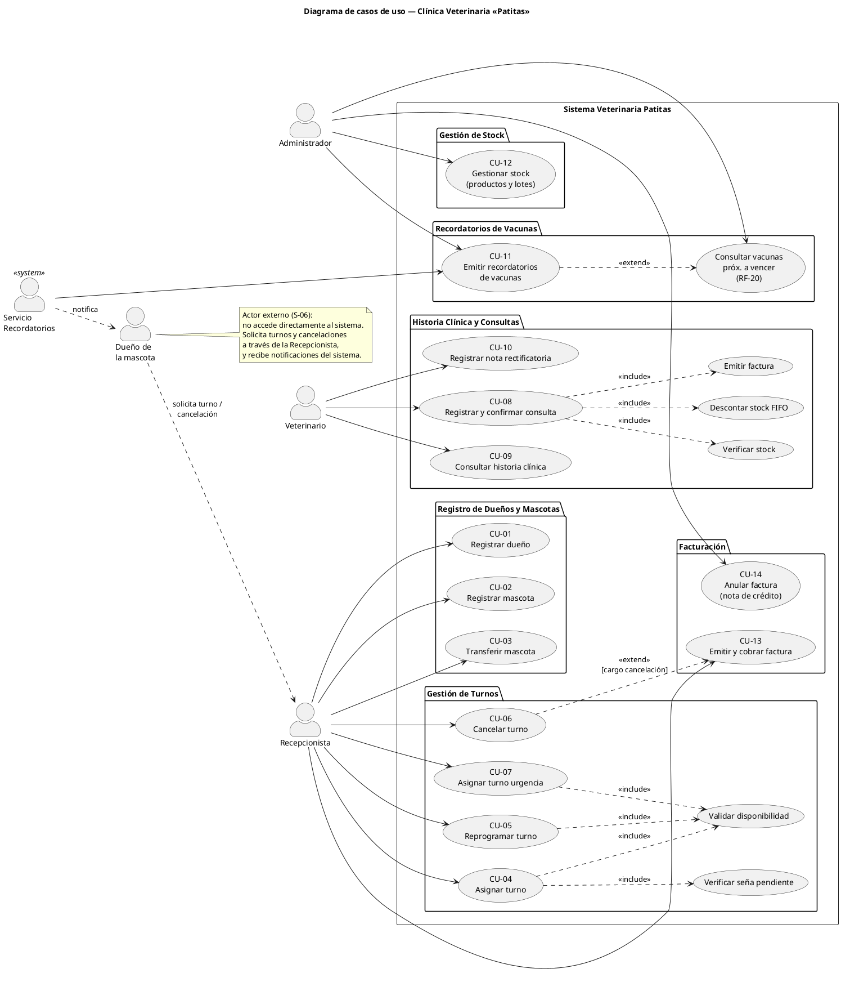
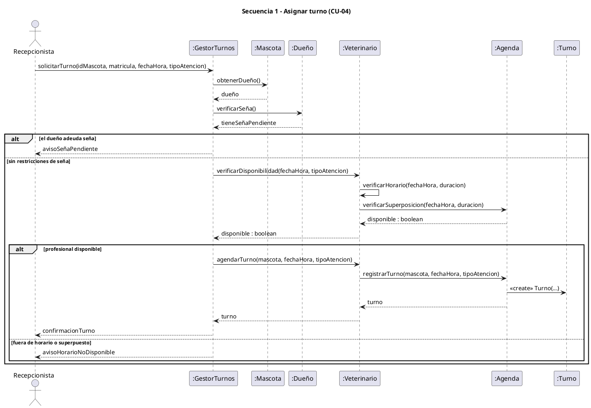
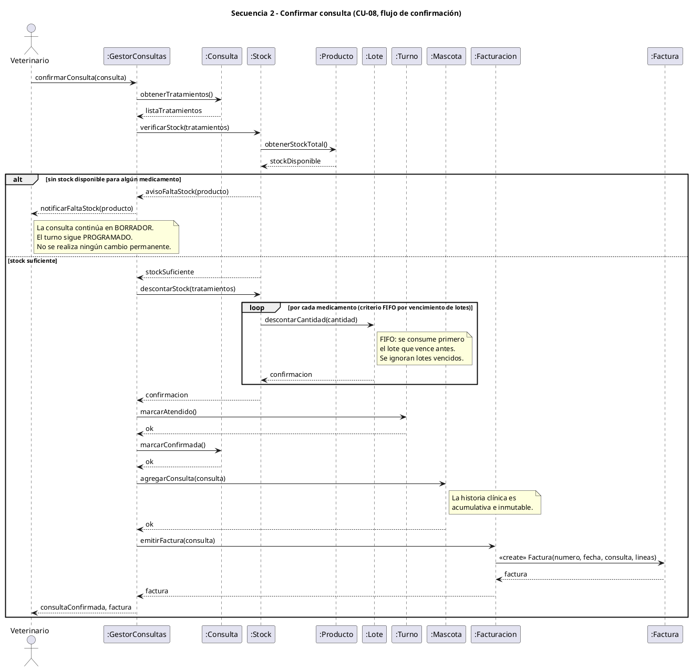

# Etapa 1 — Clínica Veterinaria «Patitas»

**Propuesta elegida:** B — Clínica veterinaria «Patitas»
**Materia:** Paradigma Orientado a Objetos (UADE) — TPO, Etapa 1

## Integrantes

| Integrante            | Legajo  |
| --------------------- | ------- |
| Milena Luciana Mendez | 1214694 |
| Adrian Maldonado      | 1220625 |
| Santiago Coco         | 1220810 |

## Índice

1. Análisis del enunciado (contexto, actores, requerimientos funcionales, reglas de negocio, requisitos técnicos y supuestos)
2. Casos de uso (CU-01 a CU-14 y diagrama de casos de uso)
3. Diagrama de clases inicial
4. Diagramas de secuencia (Asignar turno y Confirmar consulta)
5. Aplicación de patrones SOLID y GRASP
6. Diagrama de clases final y nota de cambios

---

# 1. Análisis del enunciado

**Propuesta elegida:** B — Clínica veterinaria «Patitas»
**Materia:** Paradigma Orientado a Objetos (UADE) — TPO, Etapa 1

---

## 1.1 Contexto

Una clínica veterinaria con varios profesionales quiere informatizar la atención de pacientes, los turnos y el control de insumos. El sistema debe cubrir: registro de dueños y mascotas, gestión de turnos, consultas con historia clínica, control de stock, facturación y recordatorios de vacunas.

---

## 1.2 Actores

| Actor | Descripción | Responsabilidades principales |
|---|---|---|
| **Recepcionista** | Personal de recepción. | Registra dueños y mascotas, transfiere mascotas, asigna / reprograma / cancela turnos, registra urgencias y ausencias, emite facturas y registra cobros. **No** puede registrar diagnósticos ni tratamientos (RN-HC-03). |
| **Veterinario** | Profesional con matrícula, especialidad y horario de atención por día. | Registra consultas, diagnósticos y tratamientos, aplica vacunas, firma notas rectificatorias y confirma la consulta. Puede estar de guardia. |
| **Dueño de la mascota** | Cliente, responsable de una o más mascotas; puede estar adherido a un plan de salud animal. | Solicita turnos y cancelaciones (a través de recepción), paga las facturas y recibe notificaciones (recordatorios de vacunas, reprogramaciones). Actor externo sin acceso directo al sistema (ver S-06). |
| **Administrador** | Personal de gestión de la clínica. | Gestiona veterinarios, horarios y guardias, catálogo de vacunas, productos y lotes; consulta turnos por veterinario, stock bajo y vacunas próximas a vencer; anula facturas mediante nota de crédito. |

> De todo el personal se conoce nombre, apellido, documento y teléfono. Los recordatorios y alertas los genera el propio sistema (no es un actor humano; ver S-11).

---

## 1.3 Requerimientos funcionales

**CU mín.** = caso de uso mínimo del enunciado: (1) registrar dueños y mascotas · (2) turnos · (3) consultas e historia clínica · (4) stock · (5) facturación · (6) recordatorios de vacunas. Los marcados con «—» se derivan del enunciado de modelado.

### Dueños y mascotas

| ID | Requerimiento | CU mín. | Actor |
|---|---|---|---|
| RF-01 | Registrar dueños (nombre, apellido, documento, teléfono, correo electrónico). | 1 | Recepcionista |
| RF-02 | Adherir o dar de baja a un dueño del plan de salud animal. | — | Recepcionista |
| RF-03 | Registrar mascotas asociadas a un dueño, con datos comunes (nombre, especie, raza, sexo, fecha de nacimiento, peso actual) y datos propios de la especie: perro (chip, tamaño), gato (interior/exterior), ave (puede volar), conejo (ver S-01). | 1 | Recepcionista |
| RF-04 | Transferir una mascota a otro dueño conservando su historia clínica. | 1 | Recepcionista |

### Turnos

| ID | Requerimiento | CU mín. | Actor |
|---|---|---|---|
| RF-05 | Asignar un turno (mascota, veterinario, fecha y hora, tipo de atención) validando horario del profesional y superposición. | 2 | Recepcionista |
| RF-06 | Reprogramar un turno. | 2 | Recepcionista |
| RF-07 | Cancelar un turno, aplicando cargo si corresponde. | 2 | Recepcionista |
| RF-08 | Registrar ausencias, contabilizar las consecutivas y exigir seña al llegar a tres. | 2 | Recepcionista |
| RF-09 | Asignar un turno de urgencia al profesional de guardia, desplazando y reprogramando el turno siguiente si hace falta, y notificando al dueño. | 2 | Recepcionista |
| RF-10 | Consultar los turnos de cada veterinario. | — | Administrador / Veterinario |
| RF-11 | Registrar veterinarios con su matrícula, especialidad, horario por día y guardias. | — | Administrador |

### Consultas e historia clínica

| ID | Requerimiento | CU mín. | Actor |
|---|---|---|---|
| RF-12 | Registrar una consulta (motivo, peso del día, diagnóstico, observaciones) vinculada a un turno. | 3 | Veterinario |
| RF-13 | Indicar tratamientos en una consulta (medicamento, dosis, frecuencia, duración), exigiendo peso registrado. | 3 | Veterinario |
| RF-14 | Aplicar vacunas en una consulta (lote y fecha), validando edad mínima y calculando el próximo refuerzo. | 3 | Veterinario |
| RF-15 | Confirmar la consulta: descuenta stock, marca el turno como atendido, incorpora la consulta a la historia clínica y dispara la facturación. | 3 | Veterinario |
| RF-16 | Consultar la historia clínica de una mascota (conjunto de consultas). | 3 | Veterinario |
| RF-17 | Registrar una nota rectificatoria firmada sobre un registro de la historia clínica. | 3 | Veterinario |

### Vacunas

| ID | Requerimiento | CU mín. | Actor |
|---|---|---|---|
| RF-18 | Mantener el catálogo de vacunas (nombre, especies, edad mínima, intervalo de refuerzo). | — | Administrador |
| RF-19 | Emitir recordatorios 7 días antes del vencimiento del refuerzo y determinar vacunas vencidas (30 días sin aplicar). | 6 | Sistema → Dueño |
| RF-20 | Consultar vacunas próximas a vencer. | 6 | Administrador |

### Stock de insumos

| ID | Requerimiento | CU mín. | Actor |
|---|---|---|---|
| RF-21 | Registrar productos (código, nombre, stock mínimo, proveedor) y la recepción de lotes (cantidad y fecha de vencimiento). | 4 | Administrador |
| RF-22 | Descontar stock tomando primero el lote que vence antes; rechazar insumos sin stock o lotes vencidos. | 4 | Sistema |
| RF-23 | Generar una alerta de reposición cuando el stock llega al mínimo. | 4 | Sistema |
| RF-24 | Consultar productos con stock bajo. | 4 | Administrador |

### Facturación

| ID | Requerimiento | CU mín. | Actor |
|---|---|---|---|
| RF-25 | Emitir una factura por consulta, con número, fecha y líneas (consulta e insumos con cantidad y precio). | 5 | Recepcionista |
| RF-26 | Registrar el pago en efectivo, débito o crédito en cuotas, calculando descuentos y recargos. | 5 | Recepcionista |
| RF-27 | Anular una factura emitida mediante una nota de crédito (la factura nunca se modifica). | 5 | Administrador |

### Transversal

| ID | Requerimiento | CU mín. | Actor |
|---|---|---|---|
| RF-28 | Controlar permisos por rol (por ejemplo, solo el veterinario registra diagnósticos y tratamientos). | — | Sistema |

---

## 1.4 Reglas de negocio

### Turnos

| ID | Regla |
|---|---|
| RN-TUR-01 | La duración depende del tipo de atención: consulta general 30 min, vacunación 15 min, cirugía 120 min. |
| RN-TUR-02 | Cada profesional atiende dentro de su propio horario (ej.: lunes a sábado de 9 a 19) y no puede tener dos turnos superpuestos. |
| RN-TUR-03 | Un turno se cancela sin cargo hasta 2 horas antes. Pasado ese plazo se cobra el 20 % de la consulta. |
| RN-TUR-04 | Quien falta sin avisar queda como ausente. Con tres ausencias seguidas debe pagar una seña para pedir nuevos turnos. |
| RN-TUR-05 | Una urgencia toma el primer horario del profesional de guardia. Si está ocupado, desplaza al turno siguiente, que se reprograma y se notifica al dueño. |

### Mascotas e historia clínica

| ID | Regla |
|---|---|
| RN-HC-01 | Toda mascota tiene un dueño responsable; un dueño puede tener varias mascotas. Si la mascota se transfiere, conserva su historia clínica. |
| RN-HC-02 | Cada especie (perro, gato, ave, conejo) tiene datos propios y su propio calendario de vacunación. |
| RN-HC-03 | Solo un veterinario puede registrar diagnósticos y tratamientos; recepción no puede. |
| RN-HC-04 | La historia clínica solo admite nuevos registros: nada se borra ni se modifica. Un error se corrige con una nota rectificatoria firmada por el profesional. |
| RN-HC-05 | No se puede indicar un medicamento si en esa consulta no se registró el peso del animal. |

### Vacunas

| ID | Regla |
|---|---|
| RN-VAC-01 | Cada vacuna aplicada se registra con su lote y fecha; el sistema calcula el próximo refuerzo según la especie. |
| RN-VAC-02 | Se emite un recordatorio 7 días antes del vencimiento del refuerzo. Pasados 30 días sin aplicarlo, la vacuna se considera vencida. |
| RN-VAC-03 | No se puede aplicar una vacuna a un animal menor a la edad mínima definida para esa vacuna. |

### Stock de insumos

| ID | Regla |
|---|---|
| RN-STK-01 | Cada insumo tiene un stock mínimo; al llegar a ese valor se genera una alerta de reposición. |
| RN-STK-02 | No se puede aplicar ni vender un insumo sin stock. El stock se descuenta al confirmar la consulta, no al indicar el tratamiento. |
| RN-STK-03 | Se consume primero el lote con vencimiento más próximo; un lote vencido no puede usarse. |

### Facturación

| ID | Regla |
|---|---|
| RN-FAC-01 | La factura incluye la consulta y los insumos utilizados. |
| RN-FAC-02 | Efectivo: 10 % de descuento. Débito: sin recargo. Crédito en cuotas: 8 % de recargo. |
| RN-FAC-03 | Los clientes con plan de salud animal tienen 15 % de descuento. No se acumula con el de efectivo: se aplica el mayor. |
| RN-FAC-04 | Una factura emitida no se modifica. Si hay un error, se anula con una nota de crédito. |

---

## 1.5 Requisitos técnicos (no funcionales)

| Requisito | Detalle |
|---|---|
| Lenguaje | Java 17 o superior, organizado en paquetes. |
| Herencia y polimorfismo | Al menos una jerarquía con sobreescritura de métodos y uso de clases abstractas o interfaces. |
| Encapsulamiento | Atributos privados, constructores adecuados, modificadores de acceso correctos (incluido `protected` donde corresponda). |
| Colecciones | Colecciones apropiadas, con orden natural (`Comparable`) y personalizado (`Comparator`) en al menos un caso. |
| Excepciones | `try`/`catch`/`finally` y al menos una excepción propia lanzada con `throw`/`throws` para reglas de negocio. |
| Entrada y salida | Persistencia en archivos (lectura y escritura) que conserve la información entre ejecuciones. |
| Interfaz | Consola con menú o interfaz gráfica con manejo de eventos (esta última cuenta como mejora). |
| Patrones | 3 principios SOLID y 4 patrones GRASP visibles en el código. |
| Pruebas | Pruebas unitarias sobre la lógica de negocio y plan de pruebas funcionales. |
| Estilo | Nombres claros, métodos breves, comentarios donde la lógica no sea evidente. |

---

## 1.6 Supuestos

> **Estado: propuestos.** Cubren las ambigüedades detectadas en el enunciado y deben ser confirmados por el grupo antes de modelar. Los que más impactan el diseño de clases son S-02, S-05, S-09, S-13 y S-15.

| ID | Tema | Ambigüedad detectada | Supuesto adoptado |
|---|---|---|---|
| S-01 | Datos del conejo | El enunciado define datos propios para perro, gato y ave, pero no para conejo (que sí figura en las reglas). | El conejo guarda su **tipo de pelaje** (corto / largo). |
| S-02 | Descuentos y recargos | No se aclara cómo se combinan plan de salud, medio de pago y recargo del crédito. | Orden de cálculo: (1) subtotal; (2) descuento = **el mayor** entre efectivo (10 %) y plan de salud (15 %); (3) recargo del 8 % si es crédito, aplicado sobre el monto ya descontado. Débito: sin recargo. |
| S-03 | Seña y ausencias | No se define el monto de la seña ni cuándo se reinicia el contador de ausencias. | Las ausencias se cuentan **por dueño** (cualquiera de sus mascotas). Con tres consecutivas, cada nuevo turno exige una seña de monto fijo parametrizable (ej.: 30 % de la consulta general), que se descuenta de la factura. El contador se reinicia cuando una mascota del dueño es atendida. |
| S-04 | Cancelación tardía | «20 % de la consulta» no aclara sobre qué precio ni cómo se cobra; no se dice qué pasa al reprogramar. | Es el 20 % del precio del tipo de atención del turno, registrado como cargo y cobrado aparte. Reprogramar a pedido del dueño con menos de 2 h de anticipación se trata como cancelación tardía; la reprogramación por urgencia, iniciada por la clínica, no tiene cargo. |
| S-05 | Urgencias y guardia | No se define quién es el «profesional de guardia», qué es el «primer horario» ni qué pasa si el turno desplazado choca con otro. | Cada día el administrador designa **un veterinario de guardia**. La urgencia ocupa el primer hueco libre a partir del momento del pedido, dentro de su horario, con duración de consulta general (30 min). Si está ocupado, se desplaza **solo el turno programado siguiente**, que se reubica en el primer hueco libre del mismo veterinario (puede ser otro día), sin desplazamientos en cadena. Se notifica al dueño. |
| S-06 | Dueño como actor | El dueño figura como actor, pero no se indica si usa el sistema. | Actor **externo sin acceso directo**: pide turnos, cancelaciones y pagos a través de recepción y recibe notificaciones. |
| S-07 | Horario del veterinario | «Horario para cada día de la semana» no aclara si admite varios tramos. | Un único tramo continuo por día (o día sin atención). Un turno debe entrar completo dentro del tramo. |
| S-08 | Especies | No se aclara si se admiten otras especies. | Solo perro, gato, ave y conejo; el diseño debe permitir agregar especies sin modificar las existentes. |
| S-09 | Calendario de vacunación | El catálogo tiene un intervalo de refuerzo por vacuna, pero la regla dice que el refuerzo depende de la especie. | El catálogo guarda una entrada por **(vacuna, especie)** con edad mínima e intervalo de refuerzo. El «calendario» de una especie es el conjunto de sus entradas. |
| S-10 | Fechas de refuerzo | No se precisa qué fecha es el «vencimiento del refuerzo». | `fechaRefuerzo = fechaAplicación + intervalo`. El recordatorio se emite desde `fechaRefuerzo − 7 días`. La vacuna se considera **vencida** si pasaron más de 30 días desde `fechaRefuerzo` sin aplicar el refuerzo. |
| S-11 | Notificaciones | No se dice cómo se avisa al dueño ni cuándo se generan los recordatorios. | Las notificaciones son **simuladas** (se muestran por consola y se registran en archivo; no hay envío real de mail o SMS). Los recordatorios se generan a demanda desde el menú y al iniciar el sistema. |
| S-12 | Edad mínima | No se define la unidad. | Se mide en **semanas**, calculada a la fecha de aplicación a partir de la fecha de nacimiento. |
| S-13 | Origen de medicamentos y vacunas | No se aclara si medicamentos y vacunas salen del stock de la clínica. | Todo medicamento indicado y toda vacuna aplicada se provee desde el stock de la clínica: cada dosis consume un producto (de ahí el lote que se registra al vacunar) y se factura como insumo. |
| S-14 | Stock y alertas | «Stock actual» no aclara si incluye lotes vencidos; «al llegar a ese valor» no indica el operador. | Stock disponible = suma de los lotes **no vencidos**. La alerta se genera cuando `stock ≤ mínimo`, una sola vez por cruce, hasta que se reponga. |
| S-15 | Confirmar la consulta | El enunciado habla de «confirmar la consulta» sin definir el momento ni sus efectos. | La consulta nace en **borrador** (editable y sin efectos). Al indicar un tratamiento solo se verifica disponibilidad (no se reserva). Al **confirmar**: se vuelve a verificar stock, se descuenta por lote más próximo a vencer, el turno pasa a *atendido*, la consulta entra a la historia clínica (ya inmutable) y se emite la factura. |
| S-16 | Roles y acceso | No se define quién ejecuta cada función ni cómo se identifica el usuario. | Recepcionista: dueños, mascotas, turnos, facturas y cobros. Veterinario: consultas, diagnósticos, tratamientos, vacunas, notas rectificatorias y confirmación. Administrador: veterinarios, horarios y guardias, catálogo de vacunas, productos y lotes, consultas y notas de crédito. No hay login: al iniciar se elige un usuario del personal y el sistema valida permisos según su rol. |
| S-17 | Facturación | No se aclara cuántas facturas se emiten, cómo se fijan los precios, si las cuotas afectan el recargo ni qué efecto tiene una nota de crédito. | Una factura por consulta confirmada. El precio de la consulta surge de una tarifa por tipo de atención y el de los insumos de cada producto (valores de referencia cargados en el sistema). El recargo del crédito es **fijo (8 %)** sin importar la cantidad de cuotas, que se registra. La nota de crédito anula la factura completa y **no revierte** stock ni historia clínica; si corresponde, se emite una factura nueva. |
| S-18 | Nota rectificatoria | No figura en el enunciado de modelado. | Se asocia a una consulta de la historia clínica y guarda fecha, texto y firma del veterinario autor del registro original. El registro original queda intacto. |
| S-19 | Transferencia de mascota | No se indica si se conserva el historial de dueños. | Se registra fecha, dueño anterior y dueño nuevo. La mascota tiene un único dueño vigente. |
| S-20 | Peso del animal | No se aclara si el peso del día actualiza el peso de la mascota. | El peso de la consulta es obligatorio (> 0) para indicar medicamentos y **actualiza** el peso actual de la mascota. |
| S-21 | Estados del turno | Solo se listan los estados, sin transiciones. | *Programado* → *atendido* \| *cancelado* \| *ausente*. Recepción marca *ausente* cuando pasó la hora sin atención. No se asignan turnos en el pasado. |
| S-22 | Identificación de personas | No se indica cómo se identifica a dueños y personal. | El **documento** es único por persona y se usa como identificador de búsqueda. |

---

# 2. Casos de uso — Sistema Clínica Veterinaria «Patitas»

---

## Módulo 1 — Registro de dueños y mascotas

### CU-01: Registrar dueño

| Campo | Descripción |
|---|---|
| **Actor principal** | Recepcionista |
| **Precondición** | El actor ha iniciado sesión con rol Recepcionista. El documento del dueño no existe previamente en el sistema. |
| **Postcondición** | Se registra el dueño en el sistema sin ausencias acumuladas ni señas pendientes. |

**Flujo principal:**

1. La recepcionista selecciona la opción «Registrar nuevo dueño».
2. El sistema presenta el formulario de alta de dueño.
3. La recepcionista ingresa: nombre, apellido, número de documento, teléfono de contacto y correo electrónico.
4. El sistema valida que el documento no esté registrado previamente.
5. El sistema valida que el correo electrónico tenga formato válido.
6. El sistema registra los datos del dueño y los almacena.
7. El sistema muestra el mensaje «Dueño registrado correctamente» con los datos asignados.

**Flujos alternativos / de error:**

- **FA-01a — Documento ya registrado (paso 4):** el sistema muestra «Ya existe un dueño registrado con ese documento» y regresa al formulario sin crear el registro.
- **FA-01b — Correo con formato inválido (paso 5):** el sistema informa el error de formato y solicita corrección.
- **FA-01c — Campos obligatorios vacíos (paso 3):** el sistema resalta los campos faltantes y no avanza hasta completarlos.

---

### CU-02: Registrar mascota

| Campo | Descripción |
|---|---|
| **Actor principal** | Recepcionista |
| **Precondición** | El dueño está registrado en el sistema (RF-01). El actor tiene rol Recepcionista. |
| **Postcondición** | Se registra la mascota según su especie asociada a su dueño responsable, iniciando su historia clínica. |

**Flujo principal:**

1. La recepcionista busca al dueño por documento o nombre.
2. El sistema muestra el perfil del dueño con su lista de mascotas.
3. La recepcionista selecciona «Agregar mascota».
4. El sistema presenta el formulario de alta de mascota: nombre, especie, raza, sexo, fecha de nacimiento, peso inicial.
5. La recepcionista selecciona la especie (perro, gato, ave o conejo).
6. El sistema muestra los campos específicos de la especie seleccionada:
   - **Perro:** número de chip y tamaño (pequeño, mediano, grande).
   - **Gato:** indicador «vive en interior» (sí/no).
   - **Ave:** indicador «puede volar» (sí/no).
   - **Conejo:** tipo de pelaje (corto, largo).
7. La recepcionista completa los datos y confirma.
8. El sistema guarda la mascota, la asocia al dueño e inicializa su historia clínica.
9. El sistema muestra el mensaje «Mascota registrada correctamente».

**Flujos alternativos / de error:**

- **FA-02a — Dueño no encontrado (paso 1):** el sistema informa que no existe el dueño y ofrece la opción de registrarlo (redirige a CU-01).
- **FA-02b — Especie no contemplada (paso 5):** el sistema solo presenta las especies soportadas por la clínica.
- **FA-02c — Fecha de nacimiento futura (paso 7):** el sistema rechaza la fecha y solicita corrección.
- **FA-02d — Peso inicial no positivo:** el sistema informa que el peso debe ser mayor que cero.

---

### CU-03: Transferir mascota

| Campo | Descripción |
|---|---|
| **Actor principal** | Recepcionista |
| **Precondición** | La mascota y ambos dueños (cedente y receptor) existen en el sistema. |
| **Postcondición** | La mascota queda asociada al nuevo dueño. La historia clínica se conserva íntegramente. |

**Flujo principal:**

1. La recepcionista busca la mascota por nombre o identificador.
2. El sistema muestra la ficha de la mascota con su dueño actual.
3. La recepcionista selecciona «Transferir mascota».
4. El sistema solicita el documento del nuevo dueño.
5. La recepcionista ingresa el documento del nuevo dueño.
6. El sistema localiza al nuevo dueño y muestra su nombre para confirmación.
7. La recepcionista confirma la transferencia.
8. El sistema actualiza la vinculación de la mascota asignándole el nuevo dueño responsable, conservando intacta su historia clínica acumulada.
9. El sistema registra la fecha y los involucrados en un evento de auditoría de la transferencia.
10. El sistema informa «Mascota transferida correctamente».

**Flujos alternativos / de error:**

- **FA-03a — Nuevo dueño no registrado (paso 6):** el sistema informa que el documento no corresponde a ningún dueño registrado y ofrece registrarlo primero.
- **FA-03b — Nuevo dueño igual al actual:** el sistema informa que la mascota ya pertenece a ese dueño y cancela la operación.

---

## Módulo 2 — Gestión de turnos

### CU-04: Asignar turno

| Campo | Descripción |
|---|---|
| **Actor principal** | Recepcionista |
| **Precondición** | La mascota y el veterinario existen en el sistema. El actor tiene rol Recepcionista. |
| **Postcondición** | Se registra un turno en estado programado asociado a la mascota y al veterinario, dentro de su horario de atención y sin superposición. |

**Flujo principal:**

1. La recepcionista selecciona «Nuevo turno».
2. Ingresa el identificador de la mascota, la matrícula del veterinario, la fecha y hora deseada y el tipo de atención (consulta general, vacunación o cirugía).
3. El sistema determina la duración según el tipo de atención: consulta general 30 minutos, vacunación 15 minutos, cirugía 120 minutos.
4. El sistema verifica si el dueño de la mascota adeuda una seña por ausencias previas.
5. El sistema verifica que la fecha y hora propuestas se encuentren dentro del horario de atención configurado para el veterinario.
6. El sistema verifica que no exista superposición de horarios con otros turnos ya agendados para ese veterinario.
7. El sistema registra el nuevo turno en estado programado en la agenda del veterinario.
8. El sistema confirma el turno a la recepcionista con fecha, hora y número de turno asignado.

**Flujos alternativos / de error:**

- **FA-04a — Seña pendiente (paso 4):** el sistema advierte que el dueño adeuda una seña por registrar tres ausencias consecutivas; la recepcionista debe registrar el cobro de la seña antes de confirmar el turno.
- **FA-04b — Fuera del horario del veterinario (paso 5):** el sistema advierte que el horario está fuera de la franja de atención del veterinario e informa su disponibilidad horaria.
- **FA-04c — Superposición de turno (paso 6):** el sistema informa que el profesional ya tiene un turno asignado en ese horario y sugiere los próximos horarios libres.

---

### CU-05: Reprogramar turno

| Campo | Descripción |
|---|---|
| **Actor principal** | Recepcionista |
| **Precondición** | El turno existe en estado programado. La nueva fecha y hora está disponible en la agenda del mismo veterinario. |
| **Postcondición** | El turno actualiza su fecha y hora manteniendo su estado programado. Se registra la reprogramación. |

**Flujo principal:**

1. La recepcionista busca el turno por número o por mascota.
2. El sistema muestra los datos actuales del turno.
3. La recepcionista selecciona «Reprogramar» e ingresa la nueva fecha y hora.
4. El sistema aplica las mismas validaciones de disponibilidad que en CU-04: horario de atención y verificación de superposiciones.
5. El sistema actualiza la fecha y hora del turno existente.
6. El sistema informa que la reprogramación fue exitosa.

**Flujos alternativos / de error:**

- **FA-05a — Turno ya atendido o cancelado:** el sistema informa que el turno no puede reprogramarse y cancela la operación.
- **FA-05b — Nuevo horario no disponible:** ídem FA-04b / FA-04c.

---

### CU-06: Cancelar turno

| Campo | Descripción |
|---|---|
| **Actor principal** | Recepcionista |
| **Precondición** | El turno existe en estado programado. |
| **Postcondición** | El turno queda en estado cancelado. Si se cancela con menos de 2 horas de anticipación, se registra un cargo equivalente al 20 % de la atención. |

**Flujo principal:**

1. La recepcionista busca el turno y selecciona «Cancelar turno».
2. El sistema calcula el tiempo restante hasta la hora del turno.
3. Si el tiempo restante es mayor o igual a 2 horas: se cancela sin cargo.
4. Si el tiempo restante es menor a 2 horas: el sistema informa que se aplicará un cargo del 20 % del arancel correspondiente al tipo de atención y solicita confirmación.
5. La recepcionista confirma.
6. El sistema cambia el estado del turno a cancelado y, si corresponde, registra el cargo pendiente al dueño.
7. El sistema informa la cancelación.

**Flujos alternativos / de error:**

- **FA-06a — Recepcionista no confirma el cargo:** se cancela la operación; el turno permanece programado.
- **FA-06b — Turno ya cancelado o atendido:** el sistema informa que la operación no es aplicable.

---

### CU-07: Asignar turno de urgencia

| Campo | Descripción |
|---|---|
| **Actor principal** | Recepcionista |
| **Precondición** | Existe un veterinario de guardia designado para el día actual por el Administrador. La mascota está registrada. |
| **Postcondición** | Se registra un turno de urgencia con duración de 30 minutos en el primer espacio disponible del veterinario de guardia a partir del momento actual. Si ocupa el horario previo a un turno programado, este último se desplaza solo una posición. |

**Flujo principal:**

1. La recepcionista selecciona «Turno de urgencia».
2. El sistema identifica al veterinario de guardia del día.
3. El sistema busca el primer espacio libre a partir del momento actual en la agenda del veterinario de guardia.
4. Si el turno de urgencia (30 min) se ubica inmediatamente antes de un turno programado existente, ese turno se desplaza 30 min hacia adelante, siempre que no supere el horario de atención del veterinario. El desplazamiento no se propaga en cadena.
5. El sistema registra el turno con carácter de urgencia, lo asigna a la agenda y confirma a la recepcionista.

**Flujos alternativos / de error:**

- **FA-07a — Sin veterinario de guardia asignado:** el sistema informa que no hay guardia designada para hoy y sugiere contactar al administrador.
- **FA-07b — Sin hueco disponible en la guardia:** el sistema informa que la agenda del veterinario de guardia está completa y no es posible asignar la urgencia.
- **FA-07c — Desplazamiento dejaría turno fuera de horario:** el sistema no desplaza el turno existente e informa la situación; la recepcionista decide manualmente.

---

## Módulo 3 — Historia clínica y consultas

### CU-08: Registrar consulta y confirmarla

| Campo | Descripción |
|---|---|
| **Actor principal** | Veterinario |
| **Precondición** | El turno existe en estado programado. El actor tiene rol con permiso de registrar consultas (Veterinario). |
| **Postcondición** | La consulta queda en estado confirmada. Se descuenta el stock consumido, el turno pasa a estado atendido, la consulta se incorpora a la historia clínica de la mascota (inmutable) y se genera la factura correspondiente. |

**Flujo principal:**

1. El veterinario selecciona el turno programado.
2. El sistema inicia una consulta en estado borrador asociada al turno.
3. El veterinario registra el motivo de la consulta y el peso del día de la mascota.
4. El veterinario registra el diagnóstico y las observaciones clínicas.
5. Opcionalmente el veterinario agrega tratamientos: para cada uno selecciona el medicamento del catálogo e ingresa dosis, frecuencia y duración. El sistema valida que se haya registrado previamente el peso del día (RF-13).
6. Opcionalmente el veterinario aplica vacunas: selecciona la vacuna del catálogo e indica el lote. El sistema valida la edad mínima requerida de la mascota y calcula la fecha del próximo refuerzo.
7. El veterinario selecciona «Confirmar consulta».
8. El sistema verifica que haya disponibilidad de stock suficiente para cada medicamento indicado en los tratamientos.
9. El sistema descuenta el stock de cada insumo utilizado consumiendo prioritariamente los lotes no vencidos con fecha de vencimiento más próxima (criterio FIFO).
10. El sistema actualiza el estado del turno a atendido.
11. El sistema incorpora la consulta confirmada a la historia clínica de la mascota de manera permanente e inmutable.
12. El sistema emite la factura correspondiente por la consulta y los medicamentos administrados.
13. El sistema confirma al veterinario que la consulta fue registrada y la factura emitida.

**Flujos alternativos / de error:**

- **FA-08a — Sin stock disponible (paso 8):** el sistema alerta sobre la falta de stock del producto solicitado; no realiza ningún descuento ni cambio permanente, el turno permanece programado y la consulta continúa en borrador. El veterinario puede modificar el tratamiento o posponer la confirmación.
- **FA-08b — Lote vencido detectado (paso 9):** el sistema omite el lote vencido y utiliza el siguiente lote vigente en orden FIFO. Si no hay lotes vigentes con stock suficiente, aplica FA-08a.
- **FA-08c — Mascota menor a la edad mínima para la vacuna (paso 6):** el sistema advierte que la mascota no cumple con la edad mínima requerida para la vacuna y no permite su aplicación.
- **FA-08d — Sin peso del día al intentar agregar tratamiento (paso 5):** el sistema informa que el registro del peso es obligatorio antes de indicar medicamentos cuya dosificación depende de él.

---

### CU-09: Consultar historia clínica

| Campo | Descripción |
|---|---|
| **Actor principal** | Veterinario |
| **Precondición** | La mascota tiene al menos una consulta confirmada registrada. |
| **Postcondición** | Sin cambios en el sistema (operación de solo lectura). |

**Flujo principal:**

1. El veterinario busca la mascota por nombre o identificador.
2. El sistema muestra la ficha de la mascota.
3. El veterinario selecciona «Ver historia clínica».
4. El sistema recupera y muestra el historial de consultas de la historia clínica de la mascota en orden cronológico, con sus diagnósticos, tratamientos, vacunas aplicadas y notas rectificatorias asociadas.
5. El veterinario puede expandir cada entrada para examinar el detalle completo de la atención.

**Flujos alternativos / de error:**

- **FA-09a — Historia clínica vacía:** el sistema informa que la mascota no posee consultas registradas aún.

---

### CU-10: Registrar nota rectificatoria

| Campo | Descripción |
|---|---|
| **Actor principal** | Veterinario |
| **Precondición** | La consulta a rectificar existe en estado confirmada. El veterinario firmante tiene matrícula habilitada. |
| **Postcondición** | Se registra una nota rectificatoria vinculada a la consulta original. La consulta original no se modifica. |

**Flujo principal:**

1. El veterinario selecciona la consulta confirmada que desea rectificar.
2. El veterinario selecciona «Agregar nota rectificatoria».
3. El veterinario redacta el texto aclaratorio correspondiente.
4. El sistema registra la nota rectificatoria con la referencia a la consulta, el texto, la fecha actual y la matrícula del profesional firmante.
5. El sistema vincula la nota a la consulta original y la almacena.
6. El sistema confirma «Nota rectificatoria registrada correctamente».

**Flujos alternativos / de error:**

- **FA-10a — Texto vacío:** el sistema no permite guardar la nota y solicita ingresar el texto aclaratorio.

---

## Módulo 4 — Vacunas y recordatorios

### CU-11: Emitir recordatorios de vacunas

| Campo | Descripción |
|---|---|
| **Actor principal** | Proceso automático del sistema / Administrador (para consulta manual) |
| **Precondición** | Existen vacunas aplicadas registradas en el sistema con fecha de refuerzo calculada. |
| **Postcondición** | Se emiten notificaciones (simuladas por consola y archivo de log) a los dueños cuyas mascotas tienen vacunas con refuerzo próximo en los siguientes 7 días. Las vacunas cuyo refuerzo lleva más de 30 días transcurridos se consideran vencidas. |

**Flujo principal:**

1. El proceso de recordatorios se ejecuta (automáticamente de forma periódica o a solicitud del Administrador).
2. El sistema examina las vacunas aplicadas que se encuentran activas y pendientes de refuerzo.
3. Para cada vacuna: calcula los días restantes hasta la fecha de próximo refuerzo calculada.
4. Si faltan entre 1 y 7 días: genera un recordatorio avisando la proximidad del refuerzo para el dueño de la mascota.
5. Si la fecha ya pasó y transcurrieron hasta 30 días: emite un aviso de vencimiento reciente.
6. Si transcurrieron más de 30 días sin aplicar el refuerzo: clasifica la vacuna como vencida.
7. Las notificaciones se presentan simuladas por consola y se registran en el archivo de eventos.
8. El Administrador puede consultar el listado resultante en cualquier momento (RF-20).

**Flujos alternativos / de error:**

- **FA-11a — Sin vacunas próximas:** el sistema informa que no existen recordatorios pendientes para el período analizado.

---

## Módulo 5 — Stock de medicamentos e insumos

### CU-12: Gestionar stock

| Campo | Descripción |
|---|---|
| **Actor principal** | Administrador |
| **Precondición** | El actor tiene rol Administrador. |
| **Postcondición** | El producto o lote queda registrado en el sistema. Las alertas de reposición son visibles si el stock alcanza el mínimo. |

**Flujo principal — Registrar producto:**

1. El Administrador selecciona «Gestión de stock > Nuevo producto».
2. Ingresa: código, nombre, stock mínimo y proveedor.
3. El sistema registra el nuevo producto con su stock inicial en cero.
4. El sistema confirma el alta del producto.

**Flujo principal — Registrar lote:**

1. El Administrador selecciona un producto existente.
2. Selecciona «Agregar lote» e ingresa: cantidad y fecha de vencimiento.
3. El sistema registra el lote con su cantidad y fecha de vencimiento, incorporándolo al inventario ordenado por fecha de vencimiento (criterio FIFO).
4. El sistema recalcula el stock disponible total del producto.
5. Si el stock total resulta menor o igual al stock mínimo configurado, el sistema genera una alerta de reposición (RF-23).
6. El sistema confirma el ingreso del lote.

**Flujo principal — Consultar productos con stock bajo:**

1. El Administrador selecciona «Consultar stock bajo».
2. El sistema filtra los productos cuyo stock disponible es menor o igual a su stock mínimo.
3. El sistema muestra la lista con: código, nombre, stock actual, stock mínimo y el lote con vencimiento más próximo.

**Flujos alternativos / de error:**

- **FA-12a — Código de producto duplicado:** el sistema informa que ya existe un producto registrado con ese código.
- **FA-12b — Fecha de vencimiento ya pasada al registrar lote:** el sistema advierte que el lote ya se encuentra vencido al momento del ingreso y solicita corrección.

---

## Módulo 6 — Facturación

### CU-13: Emitir y cobrar factura

| Campo | Descripción |
|---|---|
| **Actor principal** | Recepcionista |
| **Precondición** | La consulta médica acaba de confirmarse (la factura se genera automáticamente al confirmar la atención). El actor tiene rol Recepcionista. |
| **Postcondición** | La factura queda registrada en estado emitida con el monto final calculado según el medio de pago y los descuentos o recargos correspondientes. |

**Flujo principal:**

1. Al confirmarse la consulta médica (CU-08, paso 12), el sistema genera el borrador de la factura con el detalle de la consulta y los insumos utilizados.
2. La recepcionista selecciona el medio de pago: efectivo, débito o crédito en cuotas.
3. El sistema calcula el subtotal sumando los ítems de servicios y productos consumidos.
4. El sistema determina el descuento aplicable: el mayor entre (a) 10 % si el medio de pago es efectivo, o (b) 15 % si el dueño posee plan de salud animal activo (no se acumulan).
5. El sistema aplica el descuento seleccionado sobre el subtotal.
6. Si el medio de pago es crédito en cuotas, el sistema añade un recargo del 8 % sobre el monto ya descontado.
7. El sistema calcula el importe total definitivo y lo presenta a la recepcionista.
8. La recepcionista confirma el cobro.
9. El sistema registra el pago, marca la factura en estado emitida y actualiza su registro.
10. El sistema emite el comprobante de facturación.

**Flujos alternativos / de error:**

- **FA-13a — Dueño con plan de salud y pago en efectivo:** el sistema aplica el 15 % (mayor descuento) en lugar del 10 %, e informa el criterio seleccionado.
- **FA-13b — Dueño con plan de salud y pago con crédito:** el sistema aplica el 15 % de descuento y luego calcula el 8 % de recargo sobre el importe resultante con descuento.

---

### CU-14: Anular factura (nota de crédito)

| Campo | Descripción |
|---|---|
| **Actor principal** | Administrador |
| **Precondición** | La factura existe en estado emitida. El actor tiene rol Administrador. |
| **Postcondición** | La factura pasa a estado anulada. Se registra una nota de crédito vinculada a ella. |

**Flujo principal:**

1. El Administrador busca la factura por número de comprobante.
2. El sistema muestra el detalle de la factura emitida.
3. El Administrador selecciona «Anular factura» e ingresa el motivo de la anulación.
4. El sistema genera la nota de crédito con la referencia a la factura, la fecha actual y el motivo informado.
5. El sistema cambia el estado de la factura a anulada.
6. El sistema emite la nota de crédito como comprobante de anulación.
7. El sistema confirma la anulación de la factura.

**Flujos alternativos / de error:**

- **FA-14a — Factura ya anulada:** el sistema informa que la factura ya fue anulada previamente y muestra la nota de crédito asociada.
- **FA-14b — Motivo vacío:** el sistema no permite continuar sin haber registrado un motivo formal de anulación.

---

## Diagrama de casos de uso (PlantUML)



---

# 3. Diagrama de Clases Inicial

---

## 3.1 Resumen de paquetes y clases

| Paquete           | Clases                                                                                                             | Propósito                                                        |
| ----------------- | ------------------------------------------------------------------------------------------------------------------ | ---------------------------------------------------------------- |
| `enums`           | `TipoAtencion`, `EstadoTurno`, `MedioPago`, `EstadoFactura`, `EstadoConsulta`, `Sexo`, `TamanoPerro`, `TipoPelaje` | Tipos cerrados del dominio                                       |
| `personas`        | `Persona`, `PersonalClinica`, `Recepcionista`, `Veterinario`, `Administrador`, `Duenio`, `TramoHorario`            | Actores del sistema y datos de personas                          |
| `mascotas`        | `Mascota`, `Perro`, `Gato`, `Ave`, `Conejo`, `TransferenciaMascota`                                                | Jerarquía de especies y historial de dueños                      |
| `turnos`          | `Turno`, `Agenda`                                                                                                  | Gestión de turnos y disponibilidad del profesional en el dominio |
| `historiaclinica` | `Consulta`, `Tratamiento`, `VacunaAplicada`, `NotaRectificatoria`                                                  | Historia clínica acumulativa e inmutable de cada mascota         |
| `vacunas`         | `VacunaDefinicion`, `ServicioRecordatoriosVacunas`                                                                 | Catálogo de vacunas y recordatorios periódicos                   |
| `stock`           | `Producto`, `Lote`, `ServicioStock`                                                                                | Control de inventario por lotes y vencimiento (FIFO)             |
| `facturacion`     | `Factura`, `LineaFactura`, `NotaCredito`                                                                           | Emisión, cálculo y anulación de comprobantes                     |

---

## 3.2 Jerarquías de herencia

### Jerarquía de personas

```text
Persona  (abstracta)
├── PersonalClinica  (abstracta)
│   ├── Recepcionista
│   ├── Veterinario
│   └── Administrador
└── Duenio
```

- `Persona` concentra los atributos comunes: `nombre`, `apellido`, `documento`, `telefono`.
- `PersonalClinica` agrupa al personal de la clínica.
- `Veterinario` extiende con `matricula`, `especialidad`, `horarioAtencion` y su propia `Agenda`.
- `Duenio` extiende con `correoElectronico`, `planSaludAnimal`, `ausenciasConsecutivas`, `senaPendiente`.

### Jerarquía de mascotas

```text
Mascota  (abstracta)
├── Perro   → numeroChip, tamano (TamanoPerro)
├── Gato    → esInterior
├── Ave     → puedeVolar
└── Conejo  → tipoPelaje (TipoPelaje)   ← supuesto S-01
```

- `Mascota` declara `getDatosEspecie(): String` como método abstracto (polimorfismo).
- Cada subclase sobrescribe `getDatosEspecie()` con sus datos propios de especie.
- Agregar una nueva especie solo requiere crear una subclase nueva sin modificar las clases existentes.

---
## 3.3 Relaciones principales

| Relación | Tipo | Multiplicidad | Descripción |
|---|---|---|---|
| `Mascota` → `Duenio` | Asociación | `*` → `1` | Toda mascota tiene un dueño responsable vigente (S-19: se registra el historial de transferencias) |
| `Mascota` ◆→ `TransferenciaMascota` | Composición | `1` ◆→ `0..*` | El historial de dueños pertenece a la mascota (S-19) |
| `TransferenciaMascota` → `Duenio` | Asociación | `*` → `1` (dos veces) | Cada transferencia referencia al dueño anterior y al dueño nuevo |
| `Veterinario` ◆→ `TramoHorario` | Composición | `1` ◆→ `0..7` | Horario de atención del profesional: un tramo continuo por día (S-07) |
| `Mascota` ◆→ `Consulta` | Composición | `1` ◆→ `0..*` | La historia clínica pertenece a la mascota; si se elimina, elimina consultas |
| `Veterinario` ◆→ `Agenda` | Composición | `1` ◆→ `1` | Cada veterinario tiene su propia agenda |
| `Agenda` ◆→ `Turno` | Composición | `1` ◆→ `0..*` | Los turnos viven dentro de la agenda del veterinario |
| `Turno` → `Mascota` | Asociación | `*` → `1` | Un turno es para una mascota específica |
| `Turno` → `Veterinario` | Asociación | `*` → `1` | Un turno corresponde a un profesional veterinario |
| `Consulta` ◆→ `Tratamiento` | Composición | `1` ◆→ `0..*` | Los tratamientos no existen fuera de una consulta |
| `Consulta` ◆→ `VacunaAplicada` | Composición | `1` ◆→ `0..*` | Las vacunas aplicadas forman parte de la consulta |
| `VacunaAplicada` → `VacunaDefinicion` | Asociación | `*` → `1` | Cada vacuna aplicada refiere a una definición del catálogo |
| `Tratamiento` → `Producto` | Asociación | `*` → `1` | El medicamento indicado es un producto del inventario |
| `Producto` ◆→ `Lote` | Composición | `1` ◆→ `1..*` | Un producto se recibe y administra en lotes |
| `Factura` → `Consulta` | Asociación | `*` → `1` | Una factura se emite por una consulta confirmada |
| `Factura` ◆→ `LineaFactura` | Composición | `1` ◆→ `1..*` | Las líneas de detalle viven dentro de la factura |
| `NotaCredito` → `Factura` | Asociación | `1` → `1` | Una nota de crédito anula una factura emitida |

---
## 3.4 Diagrama de Clases

```plantuml
@startuml
title Diagrama de Clases Inicial — Clínica Veterinaria «Patitas»
skinparam classAttributeIconSize 0

package enums {
  enum TipoAtencion {
    CONSULTA_GENERAL
    VACUNACION
    CIRUGIA
  }
  enum EstadoTurno {
    PROGRAMADO
    ATENDIDO
    CANCELADO
    AUSENTE
  }
  enum MedioPago {
    EFECTIVO
    DEBITO
    CREDITO
  }
  enum EstadoFactura {
    EMITIDA
    ANULADA
  }
  enum EstadoConsulta {
    BORRADOR
    CONFIRMADA
  }
  enum Sexo {
    MACHO
    HEMBRA
  }
  enum TamanoPerro {
    PEQUENO
    MEDIANO
    GRANDE
  }
  enum TipoPelaje {
    CORTO
    LARGO
  }
}

package personas {
  abstract class Persona {
    - nombre: String
    - apellido: String
    - documento: String
    - telefono: String
    + getDocumento(): String
  }

  abstract class PersonalClinica extends Persona {
    - legajo: String
  }

  class Recepcionista extends PersonalClinica {
  }

  class Administrador extends PersonalClinica {
  }

  class TramoHorario {
    - diaSemana: int
    - horaInicio: LocalTime
    - horaFin: LocalTime
  }

  class Veterinario extends PersonalClinica {
    - matricula: String
    - especialidad: String
    - tramosHorarios: List<TramoHorario>
    + estaDisponible(fechaHora: LocalDateTime, duracion: int): boolean
  }

  class Duenio extends Persona {
    - correoElectronico: String
    - planSaludAnimal: boolean
    - ausenciasConsecutivas: int
    - senaPendiente: boolean
    + registrarAusencia(): void
    + reiniciarAusencias(): void
    + tienePlanSalud(): boolean
  }
}

package mascotas {
  abstract class Mascota {
    - nombre: String
    - especie: String
    - raza: String
    - sexo: Sexo
    - fechaNacimiento: LocalDate
    - pesoActual: double
    + {abstract} getDatosEspecie(): String
    + actualizarPeso(nuevoPeso: double): void
    + calcularEdadSemanas(fechaRef: LocalDate): int
  }

  class Perro extends Mascota {
    - numeroChip: String
    - tamano: TamanoPerro
    + getDatosEspecie(): String
  }

  class Gato extends Mascota {
    - esInterior: boolean
    + getDatosEspecie(): String
  }

  class Ave extends Mascota {
    - puedeVolar: boolean
    + getDatosEspecie(): String
  }

  class Conejo extends Mascota {
    - tipoPelaje: TipoPelaje
    + getDatosEspecie(): String
  }

  class TransferenciaMascota {
    - fecha: LocalDate
  }
}

package turnos {
  class Agenda {
    + agregarTurno(t: Turno): void
    + buscarEspacioLibre(fecha: LocalDate): LocalDateTime
  }

  class Turno {
    - fechaHora: LocalDateTime
    - tipoAtencion: TipoAtencion
    - estado: EstadoTurno
    - esUrgencia: boolean
    + cancelar(horasAnticipacion: int): void
    + marcarAusente(): void
    + marcarAtendido(): void
    + reprogramar(nuevaFecha: LocalDateTime): void
    + getDuracionMinutos(): int
  }
}

package historiaclinica {
  class Consulta {
    - fecha: LocalDate
    - motivo: String
    - pesoDia: double
    - diagnostico: String
    - observaciones: String
    - estado: EstadoConsulta
    + agregarTratamiento(t: Tratamiento): void
    + agregarVacuna(v: VacunaAplicada): void
    + confirmar(): void
  }

  class Tratamiento {
    - dosis: String
    - frecuencia: String
    - duracionDias: int
  }

  class VacunaAplicada {
    - fechaAplicacion: LocalDate
    - lote: String
    - fechaProximoRefuerzo: LocalDate
  }

  class NotaRectificatoria {
    - fecha: LocalDate
    - texto: String
    - matriculaFirmante: String
  }
}

package vacunas {
  class VacunaDefinicion {
    - nombre: String
    - especiesCompatibles: List
    - edadMinimaSemanas: int
    - intervaloRefuerzoDias: int
    + calcularFechaRefuerzo(fechaAplicacion: LocalDate): LocalDate
  }
}

package stock {
  class Producto {
    - codigo: String
    - nombre: String
    - stockMinimo: int
    - proveedor: String
    + getStockDisponible(): int
    + requiereReposicion(): boolean
  }

  class Lote {
    - cantidad: int
    - fechaVencimiento: LocalDate
    + estaVencido(fechaActual: LocalDate): boolean
    + descontarCantidad(cant: int): void
  }
}

package facturacion {
  class Factura {
    - numero: int
    - fecha: LocalDate
    - medioPago: MedioPago
    - estado: EstadoFactura
    - descuentoAplicado: double
    - recargoAplicado: double
    + calcularTotal(): double
    + anular(): void
  }

  class LineaFactura {
    - descripcion: String
    - cantidad: int
    - precioUnitario: double
    + getSubtotal(): double
  }

  class NotaCredito {
    - numero: int
    - fecha: LocalDate
    - motivo: String
  }
}

' Relaciones - Multiplicidades y Direcciones

Mascota "*" --> "1" Duenio : tiene responsable >
Mascota "1" *-- "*" Consulta : posee historia clinica >
Mascota "1" *-- "*" TransferenciaMascota : historial de dueños >
TransferenciaMascota "*" --> "1" Duenio : dueño anterior
TransferenciaMascota "*" --> "1" Duenio : dueño nuevo

Veterinario "1" *-- "0..7" TramoHorario : atiende en >
Veterinario "1" *-- "1" Agenda : administra >
Agenda "1" *-- "*" Turno : contiene >

Turno "*" --> "1" Mascota : es para >
Turno "*" --> "1" Veterinario : asignado a >

Consulta "1" *-- "*" Tratamiento : indica >
Consulta "1" *-- "*" VacunaAplicada : aplica >
Consulta "1" *-- "*" NotaRectificatoria : recibe correcciones >

VacunaAplicada "*" --> "1" VacunaDefinicion : referencia a >
Tratamiento "*" --> "1" Producto : consume >

Producto "1" *-- "1..*" Lote : se compone de >

Factura "*" --> "1" Consulta : generada por >
Factura "1" *-- "1..*" LineaFactura : detalla >
NotaCredito "1" --> "1" Factura : anula a >

@enduml
```




---

# 4. Diagramas de secuencia — Sistema Clínica Veterinaria «Patitas»

---

## Secuencia 1 — Asignar turno (CU-04)

**Caso de uso cubierto:** CU-04 Asignar turno  
**Flujos alternativos cubiertos:**
- FA-04a: el dueño tiene seña pendiente por ausencias previas → aviso de seña pendiente
- FA-04b / FA-04c: el veterinario está fuera de horario o existe superposición → aviso de horario no disponible
### Descripción textual del flujo

La secuencia describe cómo la **Recepcionista** interactúa con el **Gestor de Turnos** (componente del sistema encargado de coordinar la agenda) para formalizar la asignación de un nuevo turno. El gestor coordina las validaciones de negocio consultando al dueño y al profesional veterinario antes de registrar la cita.

| Paso | Mensaje | Descripción |
|---|---|---|
| 1 | `Recepcionista → GestorTurnos : solicitarTurno(idMascota, matricula, fechaHora, tipoAtencion)` | La Recepcionista inicia la solicitud indicando la mascota, el profesional, la fecha/hora y el tipo de atención. |
| 2 | `GestorTurnos → Mascota : obtenerDueño()` | Se recupera el dueño de la mascota para validar su estado de cuenta y asistencias previas. |
| 3 | `Mascota → GestorTurnos : dueño` | La mascota retorna la referencia a su dueño responsable. |
| 4 | `GestorTurnos → Duenio : verificarSeña()` | Se consulta si el dueño registra tres ausencias consecutivas sin justificar que requieran abonar una seña previa. |
| 5 | `Duenio → GestorTurnos : tieneSeñaPendiente` | Retorna verdadero si adeuda seña. |
| 6a (alt — seña pendiente) | `GestorTurnos → Recepcionista : avisoSeñaPendiente` | Si el cliente tiene seña pendiente, la operación se interrumpe y se informa a recepción que debe registrar el cobro previo. |
| 6b (alt — sin restricciones) | `GestorTurnos → Veterinario : verificarDisponibilidad(fechaHora, tipoAtencion)` | Si no hay deuda de seña, se procede a consultar la disponibilidad del profesional. |
| 7 | `Veterinario → Veterinario : verificarHorario(fechaHora, duracion)` | El profesional comprueba si la fecha y hora se encuentran dentro de su franja horaria configurada. La duración surge del tipo de atención. |
| 8 | `Veterinario → Agenda : verificarSuperposicion(fechaHora, duracion)` | Se consulta a la agenda del profesional si existe superposición horaria con turnos agendados previamente. |
| 9 | `Agenda → Veterinario : disponible : boolean` | La agenda confirma si el intervalo está libre. |
| 10 | `Veterinario → GestorTurnos : disponible : boolean` | El veterinario comunica su disponibilidad integral. |
| 11a (alt — disponible) | `GestorTurnos → Veterinario : agendarTurno(mascota, fechaHora, tipoAtencion)` | Habiendo disponibilidad, se solicita formalizar la reserva. |
| 12 | `Veterinario → Agenda : registrarTurno(mascota, fechaHora, tipoAtencion)` | El profesional delega en su agenda la creación e incorporación del nuevo turno. |
| 13 | `Agenda → Turno : <<create>> Turno(...)` | La agenda crea la instancia del turno en estado programado. |
| 14 | `Agenda → Veterinario : turno` | Retorna el turno creado. |
| 15 | `Veterinario → GestorTurnos : turno` | Propaga el turno confirmado. |
| 16 | `GestorTurnos → Recepcionista : confirmacionTurno` | La recepcionista recibe la confirmación con los datos del turno programado. |
| 11b (alt — no disponible) | `GestorTurnos → Recepcionista : avisoHorarioNoDisponible` | Si el horario no corresponde a la atención o hay solapamiento, se notifica la indisponibilidad y se sugieren alternativas. |

### Diagrama PlantUML — Asignar turno



---

## Secuencia 2 — Confirmar consulta (CU-08, flujo de confirmación)

**Caso de uso cubierto:** CU-08 Registrar consulta y confirmarla — subetapa de confirmación  
**Flujos alternativos cubiertos:**
- FA-08a: stock insuficiente para algún medicamento o insumo indicado → alerta de falta de stock (la consulta permanece en borrador)

### Descripción textual del flujo

Esta secuencia modela el momento en que el **Veterinario** da por finalizada la atención clínica y confirma la consulta realizada. La operación asegura la coherencia del sistema: si se detecta falta de stock para cualquiera de los insumos o medicamentos prescritos, no se realiza ningún cambio permanente.

El **Gestor de Consultas** (componente del sistema a cargo de la atención médica) coordina el proceso de cierre y confirmación de la consulta clínica. Se comunica con el área de Stock para validar las existencias necesarias y efectuar el descuento de los medicamentos consumidos aplicando el orden de vencimiento (criterio FIFO). Al confirmarse, se actualiza el estado del turno a atendido, se incorpora la consulta a la historia clínica de la mascota de manera permanente y se solicita la emisión de la factura correspondiente. La historia clínica solo admite nuevos registros — cualquier aclaración o rectificación posterior se instrumenta mediante una Nota Rectificatoria firmada por el profesional (CU-10).

| Paso | Mensaje | Descripción |
|---|---|---|
| 1 | `Veterinario → GestorConsultas : confirmarConsulta(consulta)` | El Veterinario solicita confirmar la consulta clínica que se encuentra en borrador. |
| 2 | `GestorConsultas → Consulta : obtenerTratamientos()` | Recupera los tratamientos y medicamentos indicados durante la sesión. |
| 3 | `Consulta → GestorConsultas : listaTratamientos` | Retorna el detalle de tratamientos prescritos. |
| 4 | `GestorConsultas → Stock : verificarStock(tratamientos)` | Consulta al área de stock si existe cantidad suficiente para cada insumo prescrito. |
| 5 | `Stock → Producto : obtenerStockTotal()` | El control de inventario suma las cantidades de los lotes vigentes de cada producto requerido. |
| 6 | `Producto → Stock : stockDisponible` | Retorna las existencias disponibles (excluyendo lotes vencidos). |
| 7a (alt — sin stock) | `Stock → GestorConsultas : avisoFaltaStock(producto)` | Si algún medicamento no cuenta con existencias suficientes, se notifica el faltante. |
| 7b (alt — sin stock) | `GestorConsultas → Veterinario : notificarFaltaStock(producto)` | El profesional recibe la alerta de insumos faltantes; la consulta continúa en borrador y el turno en programado. |
| 8 (flujo principal) | `Stock → GestorConsultas : stockSuficiente` | Confirmación de existencias disponibles para todos los tratamientos. |
| 9 | `GestorConsultas → Stock : descontarStock(tratamientos)` | Se solicita efectivizar el descuento en el inventario. |
| 10 | `Stock → Lote : descontarCantidad(cantidad)` | Se descuenta del lote vigente con vencimiento más próximo (regla FIFO). |
| 11 | `Lote → Stock : confirmacion` | El lote confirma la actualización de sus unidades. |
| 12 | `Stock → GestorConsultas : confirmacion` | El área de inventario confirma el descuento exitoso. |
| 13 | `GestorConsultas → Turno : marcarAtendido()` | El turno vinculado a la atención pasa al estado atendido. |
| 14 | `Turno → GestorConsultas : ok` | Confirmación del cambio de estado del turno. |
| 15 | `GestorConsultas → Consulta : marcarConfirmada()` | La consulta adquiere estado confirmado. |
| 16 | `Consulta → GestorConsultas : ok` | Confirmación de la consulta formalizada. |
| 17 | `GestorConsultas → Mascota : agregarConsulta(consulta)` | La consulta confirmada se asocia a la historia clínica de la mascota de forma permanente e inmutable. |
| 18 | `Mascota → GestorConsultas : ok` | Confirmación de incorporación a la historia clínica. |
| 19 | `GestorConsultas → Facturacion : emitirFactura(consulta)` | Se solicita la emisión del comprobante con el detalle de la consulta y los productos consumidos. |
| 20 | `Facturacion → Factura : crearFactura(...)` | Se genera la factura correspondiente. |
| 21 | `Facturacion → GestorConsultas : factura` | Retorna el comprobante generado. |
| 22 | `GestorConsultas → Veterinario : consultaConfirmada, factura` | El profesional recibe la confirmación de la atención registrada y el comprobante emitido. |

---

### Diagrama PlantUML — Confirmar consulta



---

# 5. Aplicación de patrones SOLID y GRASP — Sistema Clínica Veterinaria «Patitas»

A partir del modelo de dominio inicial (documentado en la sección 3 y analizado en los diagramas de secuencia de la sección 4), se identificaron puntos de mejora en el acoplamiento, cohesión y extensibilidad del diseño. En esta sección se fundamenta la aplicación de **tres principios SOLID** y **cuatro patrones GRASP**, detallando para cada uno: el **problema detectado** en el diseño inicial, la **decisión de diseño** adoptada, las **clases donde se refleja** y la **ventaja concreta** que aporta a la arquitectura.

---

## 5.1 Principios SOLID

### 1. SRP — Principio de Responsabilidad Única *(Single Responsibility Principle)*

#### Problema detectado

En el diseño inicial, la clase `Veterinario` concentraba múltiples responsabilidades: gestionaba su información profesional, almacenaba la lista de turnos asignados, verificaba si un horario caía en su franja de atención, detectaba superposiciones con otros turnos y coordinaba el registro de las consultas clínicas. Este diseño provocaba que la clase tuviera múltiples razones de cambio no relacionadas:

- Si cambia la política de horarios o cálculo de duraciones → se debía modificar `Veterinario`.
- Si cambia el algoritmo de verificación de superposiciones en la agenda → se debía modificar `Veterinario`.
- Si cambia el flujo o la estructura de la consulta clínica → se debía modificar `Veterinario`.

La clase resultaba sobrecargada, difícil de aislar y propensa a introducir efectos colaterales ante cualquier ajuste.

#### Decisión de diseño adoptada

Se distribuyeron las responsabilidades en clases especializadas con una única razón de cambio:

| Clase | Responsabilidad única |
|---|---|
| `Veterinario` | Conoce sus datos profesionales (matrícula, especialidad) y su horario de atención por día. Solo verifica si una fecha/hora entra en su franja horaria (`dentroDeHorario()`). Delega la administración de turnos y consultas. |
| `Agenda` | Mantiene la colección de `Turno` de un único veterinario. Es responsable exclusiva de detectar superposiciones (`haySuperposicion()`) e insertar nuevos turnos (`agregarTurno()`). |
| `ControladorTurnos` | Orquesta el flujo de asignación, reprogramación y cancelación de turnos, coordinando las interacciones entre `Veterinario`, `Agenda`, `Duenio` y `Mascota` sin acoplarse a la interfaz de usuario. |
| `ControladorConsultas` | Orquesta el ciclo de vida de la atención clínica (borrador a confirmada), coordinando el registro médico, la verificación de insumos y la posterior facturación. |

Con esta separación, `Veterinario` solo cambia si varían las reglas de datos profesionales; `Agenda` solo cambia si varía la estructura de almacenamiento de turnos; y los controladores solo cambian si varía el flujo de los casos de uso correspondientes.

#### Ventaja concreta

- **Alta cohesión**: cada clase se enfoca en un único propósito del dominio.
- **Mantenibilidad y aislamiento**: modificar la lógica de turnos o de agenda no impacta en la clase del profesional veterinario.
- **Claridad del modelo**: el código y el diseño resultan directos de interpretar, separando datos de entidades de la lógica de orquestación.

---

### 2. OCP — Principio de Abierto/Cerrado *(Open/Closed Principle)*

#### Problema detectado

En un diseño sin polimorfismo ni jerarquía de mascotas, incorporar una especie nueva requeriría modificar múltiples secciones del sistema que procesan particularidades por tipo de animal:

- Métodos con estructuras `if/else` o `switch` sobre la especie para consultar datos específicos (chip, tamaño, hábitat, vuelo).
- Lógica condicional repetida para determinar el calendario de vacunación o la edad mínima según la especie.

Cada nueva especie obligaría a alterar clases centrales previamente probadas y estabilizadas, violando el principio.

#### Decisión de diseño adoptada

Se diseñó una jerarquía de herencia cerrada para modificación pero abierta para extensión mediante métodos abstractos:

```
Mascota (abstracta)
├── + getDatosEspecie() : Map<String,Object>   [abstracto]
├── + getCalendarioVacunacion() : List<VacunaDefinicion>  [abstracto]
├── Perro    → implementa con chip y tamaño
├── Gato     → implementa con indicador interior/exterior
├── Ave      → implementa con capacidad de vuelo
└── Conejo   → implementa con tipo de pelaje
```

Cualquier componente que requiera datos específicos de una mascota invoca `mascota.getDatosEspecie()` sin necesidad de consultar de qué especie concreta se trata. Para incorporar una nueva especie (por ejemplo, `Hamster`), solo se crea la subclase `Hamster extends Mascota` implementando los métodos correspondientes, sin tocar ninguna clase existente.

#### Ventaja concreta

- **Extensibilidad sin riesgo de regresión**: agregar nuevas especies no altera clases existentes ni introduce errores en funcionalidades ya probadas.
- **Eliminación de estructuras condicionales repetitivas**: se reemplazan múltiples condicionales por despacho polimórfico en tiempo de ejecución.
- Cumple directamente con el supuesto S-08 y los lineamientos de la consigna.

---

### 3. DIP — Principio de Inversión de Dependencias *(Dependency Inversion Principle)*

#### Problema detectado

En el diseño inicial:

- El proceso de confirmación de consultas dependía y creaba directamente una instancia de `ServicioStock` (clase concreta). Esto acoplaba la orquestación clínica a los detalles físicos de almacenamiento del inventario.
- La facturación contenía las fórmulas de descuento y recargo codificadas de manera rígida dentro de su propia lógica, mezclando la emisión del comprobante con las políticas comerciales de medios de pago.

Cualquier modificación en la persistencia o provisión del stock (por ejemplo, consultar un inventario centralizado o un sistema externo) obligaría a modificar la lógica de las consultas médicas.

#### Decisión de diseño adoptada

Se introdujeron dos interfaces como puntos de abstracción y desacoplamiento:

| Interfaz | Implementación concreta | Módulo cliente |
|---|---|---|
| `IServicioStock` | `ServicioStock` | `ControladorConsultas` |
| `ICalculadorDescuento` | `CalculadorDescuento` | `ControladorFacturacion` |

`ControladorConsultas` define su contrato a través de `IServicioStock` (que declara operaciones como `verificarStock()`, `descontarStock()`, `getProductosBajoMinimo()`). La implementación concreta se suministra en tiempo de instanciación. Del mismo modo, `ControladorFacturacion` delega el cálculo de bonificaciones en `ICalculadorDescuento`.

#### Ventaja concreta

- **Desacoplamiento arquitectónico**: los módulos de gestión clínica no conocen la implementación interna del módulo de stock.
- **Flexibilidad y testeabilidad**: se facilita el reemplazo de implementaciones para pruebas unitarias o futuras integraciones externas sin tocar la lógica de negocio central.
- **Contratos explícitos**: las interfaces definen con precisión los servicios requeridos entre módulos.

---

## 5.2 Patrones GRASP

### 1. Experto en Información *(Information Expert)*

#### Problema detectado

¿Quién debe verificar si un veterinario se encuentra disponible en una fecha y horario determinados? Para saberlo se requieren dos comprobaciones:

1. Si el horario solicitado se encuentra dentro de la franja de atención configurada para ese día de la semana.
2. Si existe algún turno ya programado que se superponga con el intervalo `[fechaHora, fechaHora + duracion)`.

Si esta verificación se asignaba íntegramente al controlador o a la capa superior, este objeto debía conocer en detalle la estructura interna de horarios del veterinario y la lista de citas de la agenda, violando el principio de encapsulamiento y generando alto acoplamiento.

#### Decisión de diseño adoptada

Se asignó cada responsabilidad al objeto que **posee la información**:

| Responsabilidad | Clase asignada | Información que posee |
|---|---|---|
| Verificar si el horario cae en la franja de atención | `Veterinario.dentroDeHorario(fechaHora, duracion)` | `horarioAtencion: Map<DiaSemana, TramoHorario>` |
| Verificar superposición con turnos existentes | `Agenda.haySuperposicion(fechaHora, duracion)` | `turnos: List<Turno>` completa del veterinario |
| Obtener la duración correspondiente | `Atencion.getDuracionMinutos()` | Duración fija propia de cada subclase (`ConsultaGeneral`, `Vacunacion`, `Cirugia`) |

El `ControladorTurnos` simplemente solicita a `veterinario.estaDisponible(fechaHora, atencion)`, quien delega internamente en su propia información y en su `Agenda`.

#### Ventaja concreta

- La lógica se mantiene junto con los datos que procesa, preservando el encapsulamiento.
- Reduce la complejidad y las dependencias de los coordinadores superiores.
- Si cambia el formato o la política de horarios, únicamente se modifica la clase experta.

---

### 2. Creador *(Creator)*

#### Problema detectado

En el modelo inicial no quedaba formalizado qué entidad instanciaba `Turno`, `Consulta` y `Factura`. Una decisión inadecuada sería que los controladores crearan directamente todas las instancias con constructores detallados, lo que obligaría a los controladores a conocer la estructura íntima de colecciones y datos internos de cada módulo.

#### Decisión de diseño adoptada

Se formalizó la creación asignando la responsabilidad al contenedor natural o experto en el registro de cada entidad:

| Entidad creada | Clase creadora | Justificación |
|---|---|---|
| `Turno` | `Agenda` | `Agenda` **contiene** la lista completa de turnos del profesional y es quien mantiene la coherencia de la agenda. |
| `Consulta` | `ControladorConsultas` | El controlador **orquesta** la sesión clínica y dispone de los datos del turno y los permisos requeridos. |
| `Factura` | `ControladorFacturacion` | El controlador de facturación **registra** todos los comprobantes emitidos, administra la numeración correlativa y construye las líneas de detalle. |
| `NotaRectificatoria` | `ControladorConsultas` | Posee la referencia a la consulta que se rectifica y la matrícula del profesional actuante. |
| `NotaCredito` | `ControladorFacturacion` | Posee la factura que se anula y los datos del motivo formal. |

#### Ventaja concreta

- Mantiene la creación de objetos donde residen sus datos de inicialización y almacenamiento.
- Protege la integridad de las colecciones internas (como los turnos en la agenda).
- Facilita el mantenimiento futuro si cambian los parámetros de construcción de una entidad.

---

### 3. Controlador *(Controller)*

#### Problema detectado

En ausencia de clases de control formales, la interfaz de usuario (consola o pantalla) interactuaría directamente con las entidades del dominio (`Veterinario`, `Agenda`, `Mascota`, `ServicioStock`, `Factura`). Esto generaría:

- Acoplamiento directo entre la capa de presentación y las entidades de negocio.
- Lógica de orquestación duplicada en distintos puntos de la interfaz.
- Dificultad para coordinar operaciones de múltiples pasos (por ejemplo, validar seña, verificar horario y superposiciones al reservar un turno).

#### Decisión de diseño adoptada

Se implementan controladores especializados por grupo de casos de uso (controladores de caso de uso):

| Controlador | Casos de uso que coordina | Colaboradores que orquesta |
|---|---|---|
| `ControladorTurnos` | CU-04, CU-05, CU-06, CU-07 | `Veterinario`, `Agenda`, `Turno`, `Duenio`, `Mascota` |
| `ControladorConsultas` | CU-08, CU-09, CU-10 | `Consulta`, `Turno`, `Mascota`, `IServicioStock`, `ControladorFacturacion` |
| `ControladorFacturacion` | CU-13, CU-14 | `Factura`, `NotaCredito`, `ICalculadorDescuento` |

La capa de presentación interactúa únicamente con estos controladores; no accede en forma directa a las agendas ni a los lotes de inventario. Los controladores reciben las operaciones, coordinan los objetos del dominio y retornan los resultados.

#### Ventaja concreta

- **Desacoplamiento de la interfaz**: la presentación puede modificarse o reemplazarse (consola, gráfica, API) sin afectar la lógica de negocio.
- **Reutilización**: la secuencia de negocio queda centralizada y protegida.
- **Control de permisos centralizado**: facilita validar el rol del usuario antes de ejecutar cada operación (RF-28).

---

### 4. Polimorfismo *(Polymorphism)*

#### Problema detectado

Se detectaron dos escenarios con condicionales repetitivos:

1. **Duración según el tipo de atención**: en diversos puntos se requería conocer la duración en minutos de un turno según fuera consulta general, vacunación o cirugía. Sin polimorfismo, esto requería bifurcaciones condicionales `if/else` dispersas en el código.
2. **Atributos propios de cada especie**: para presentar las fichas de las mascotas o procesar los requerimientos de vacunación, el sistema necesitaba discernir la especie mediante comprobaciones sobre el tipo de animal.

#### Decisión de diseño adoptada

Se aplicó polimorfismo en ambos aspectos:

**a) Jerarquía `Atencion` (clase abstracta con una subclase por tipo de atención):**
`Atencion` declara el método abstracto `getDuracionMinutos()` (y `getNombre()`). Cada subclase (`ConsultaGeneral` = 30 min, `Vacunacion` = 15 min, `Cirugia` = 120 min) lo sobrescribe y responde uniformemente, suprimiendo bifurcaciones en el cliente. `Turno` referencia a una `Atencion` sin conocer su tipo concreto.

**b) Métodos polimórficos en la jerarquía `Mascota`:**
`Mascota` declara los métodos abstractos `getDatosEspecie()` y `getCalendarioVacunacion()`. Cada subclase (`Perro`, `Gato`, `Ave`, `Conejo`) aporta su propia implementación sin que los clientes deban evaluar el tipo concreto.

#### Ventaja concreta

- **Eliminación de sentencias condicionales**: reemplazo de condicionales de tipo por despacho polimórfico.
- **Extensibilidad limpia**: agregar un nuevo tipo de atención o una nueva especie solo requiere añadir la subclase correspondiente, sin tocar el código cliente.
- Mejora la cohesión y simplifica la estructura general del modelo.

---

# 6. Diagrama de clases final y nota de cambios — Clínica Veterinaria «Patitas»

Documento que registra todas las modificaciones realizadas sobre el diagrama de clases inicial (sección 3) como consecuencia de la aplicación de los patrones SOLID y GRASP identificados en la sección 5.

---

## 6.1 Tabla de cambios

| # | Cambio | Motivo (patrón aplicado) | Impacto en el diseño |
|---|--------|--------------------------|----------------------|
| C-01 | Se extrae `Agenda` de `Veterinario`: la lista de turnos y los métodos `haySuperposicion()` y `agregarTurno()` pasan a `Agenda`. | **SRP** — `Veterinario` tenía demasiadas responsabilidades. | `Veterinario` queda más cohesivo. `Agenda` es una clase nueva con responsabilidad única. Asociación `Veterinario` 1 — 1 `Agenda`. |
| C-02 | Se crea `ControladorTurnos` como clase de control GRASP con métodos `asignarTurno()`, `reprogramarTurno()`, `cancelarTurno()`, `asignarUrgencia()`. | **SRP + Controlador GRASP** — orquestar turnos no es responsabilidad de `Veterinario` ni de la UI. | La UI solo conoce `ControladorTurnos`; `Veterinario` y `Agenda` quedan desacoplados de la presentación. |
| C-03 | Se crea `ControladorConsultas` como clase de control con métodos `crearConsulta()`, `agregarTratamiento()`, `aplicarVacuna()`, `confirmarConsulta()`, `registrarNotaRectificatoria()`. | **SRP + Controlador GRASP** — la lógica clínica no debe residir en `Veterinario`. | Separa el ciclo de vida de `Consulta` en un controlador específico; `Veterinario` solo es actor. |
| C-04 | Se crea `ControladorFacturacion` con métodos `emitirFactura()`, `registrarPago()`, `anularFactura()`. | **SRP + Controlador GRASP** — la facturación es un dominio independiente. | `ControladorConsultas` delega en `ControladorFacturacion` al confirmar la consulta (colaboración entre controladores). |
| C-05 | Se introducen los métodos abstractos `getDatosEspecie()` y `getCalendarioVacunacion()` en `Mascota`. Cada subclase (`Perro`, `Gato`, `Ave`, `Conejo`) los implementa. | **OCP + Polimorfismo GRASP** — evitar `switch` sobre especie en código cliente. | El código que muestra fichas o calcula vacunas invoca el método polimórfico sin condicionales. Agregar `Hamster` solo requiere una nueva subclase. |
| C-06 | El enum `TipoAtencion` se reemplaza por la clase abstracta `Atencion` con las subclases `ConsultaGeneral` (30 min), `Vacunacion` (15 min) y `Cirugia` (120 min), que sobrescriben `getDuracionMinutos()` y `getNombre()`. `Turno` referencia a `Atencion` en lugar del enum. | **Polimorfismo GRASP + OCP** — la duración y el arancel son intrínsecos al tipo de atención; agregar un tipo nuevo no debe modificar código existente. | Elimina todos los `if/switch` sobre tipo de atención en `Agenda`, `ControladorTurnos` y otros. Un nuevo tipo de atención es una subclase nueva. |
| C-07 | Se extrae la interfaz `IServicioStock` con métodos `verificarStock()`, `descontarStock()`, `getProductosBajoMinimo()`. `ServicioStock` implementa `IServicioStock`. | **DIP** — `ControladorConsultas` no debe depender de la clase concreta `ServicioStock`. | `ControladorConsultas` declara dependencia del tipo `IServicioStock`; desacopla la orquestación clínica de la implementación física del stock y favorece la flexibilidad del sistema. |
| C-08 | Se extrae la interfaz `ICalculadorDescuento` con método `calcular(subtotal, medioPago, tienePlanSalud)`. `CalculadorDescuento` implementa la regla: mayor entre (efectivo 10%, plan 15%) + 8% recargo crédito. | **DIP** — `ControladorFacturacion` no debe contener la lógica de descuento embebida. | La regla de cálculo puede modificarse o sustituirse sin tocar `ControladorFacturacion`. |
| C-09 | `Agenda` es la Creadora de `Turno` (`agregarTurno()` instancia `new Turno(...)`). | **Creador GRASP** — `Agenda` contiene todos los turnos y posee los datos de inicialización. | La responsabilidad de instanciar `Turno` no recae en el controlador. |
| C-10 | `ControladorConsultas` es el Creador de `Consulta` y `NotaRectificatoria`. | **Creador GRASP** — posee los datos del turno activo y el veterinario firmante. | Centraliza la creación de entidades clínicas en el controlador correspondiente. |
| C-11 | `ControladorFacturacion` es el Creador de `Factura` y `NotaCredito`. | **Creador GRASP** — gestiona el número correlativo, fecha y líneas. | Garantiza la integridad del número de factura (generado internamente por el controlador). |
| C-12 | `Mascota` es **abstracta**; se agrega la asociación `Duenio` 1 — * `Mascota`. | **OCP** — el diseño debe ser extensible para nuevas especies. | El sistema soporta perro, gato, ave y conejo; agregar especie = nueva subclase. |
| C-13 | Se agrega `ServicioRecordatoriosVacunas` con método `emitirRecordatorios()` que recorre `VacunaAplicada` y notifica según las reglas de 7 días / 30 días. | **SRP** — la lógica de recordatorios no pertenece ni a `Mascota` ni a `Administrador`. | Servicio de dominio independiente; la notificación se simula por consola y archivo (S-11). |
| C-14 | Se agrega `Persona` (abstracta) y `PersonalClinica` (abstracta) como raíces de la jerarquía de actores del sistema. | Estructura inicial del enunciado; facilita reutilización de atributos comunes. | `Recepcionista`, `Veterinario` y `Administrador` heredan de `PersonalClinica`. |
| C-15 | `Veterinario` reemplaza `List<TramoHorario> tramosHorarios` por `Map<DiaSemana, TramoHorario> horarioAtencion` (un tramo continuo por día, S-07); se agrega el enum `DiaSemana` y `TramoHorario` deja de guardar `diaSemana`. | **Experto en Información** — `Veterinario` posee su horario y resuelve `dentroDeHorario()` accediendo directamente al tramo del día. | Verificación de horario sin recorrer listas; el día queda como clave y no como atributo repetido en cada tramo. |

---

## 6.2 Diagrama de clases final (PlantUML)

```plantuml
@startuml
title Diagrama de clases final — Clínica Veterinaria «Patitas»

skinparam classAttributeIconSize 0
hide empty members

' ─────────────────────────────────────────
'  JERARQUÍA DE PERSONAS
' ─────────────────────────────────────────
abstract class Persona {
  # nombre : String
  # apellido : String
  # documento : String
  # telefono : String
}

abstract class PersonalClinica {
  # legajo : String
}

class Recepcionista {
}

class Veterinario {
  - matricula : String
  - especialidad : String
  - horarioAtencion : Map<DiaSemana, TramoHorario>
  + dentroDeHorario(fechaHora : LocalDateTime, duracion : int) : boolean
  + estaDisponible(fechaHora : LocalDateTime, atencion : Atencion) : boolean
  + agendarTurno(mascota : Mascota, fechaHora : LocalDateTime, atencion : Atencion) : Turno
}

class Administrador {
}

class Duenio {
  - correoElectronico : String
  - planSaludAnimal : boolean
  - ausenciasConsecutivas : int
  - senaPendiente : boolean
  + requiereSena() : boolean
  + incrementarAusencia() : void
  + resetAusencias() : void
}

Persona <|-- PersonalClinica
Persona <|-- Duenio
PersonalClinica <|-- Recepcionista
PersonalClinica <|-- Veterinario
PersonalClinica <|-- Administrador

enum DiaSemana {
  LUNES
  MARTES
  MIERCOLES
  JUEVES
  VIERNES
  SABADO
  DOMINGO
}

class TramoHorario {
  - horaInicio : LocalTime
  - horaFin : LocalTime
}

Veterinario "1" *-- "0..7" TramoHorario : horarioAtencion >
Veterinario ..> DiaSemana : clave del horario

' ─────────────────────────────────────────
'  JERARQUÍA DE MASCOTAS
' ─────────────────────────────────────────
abstract class Mascota {
  # nombre : String
  # especie : String
  # raza : String
  # sexo : Sexo
  # fechaNacimiento : LocalDate
  # pesoActual : double
  + getEdadEnSemanas() : int
  + {abstract} getDatosEspecie() : Map<String,Object>
  + {abstract} getCalendarioVacunacion() : List<VacunaDefinicion>
}

class Perro {
  - numeroChip : String
  - tamano : TamanoPerro
  + getDatosEspecie() : Map<String,Object>
  + getCalendarioVacunacion() : List<VacunaDefinicion>
}

class Gato {
  - esInterior : boolean
  + getDatosEspecie() : Map<String,Object>
  + getCalendarioVacunacion() : List<VacunaDefinicion>
}

class Ave {
  - puedeVolar : boolean
  + getDatosEspecie() : Map<String,Object>
  + getCalendarioVacunacion() : List<VacunaDefinicion>
}

class Conejo {
  - tipoPelaje : TipoPelaje
  + getDatosEspecie() : Map<String,Object>
  + getCalendarioVacunacion() : List<VacunaDefinicion>
}

Mascota <|-- Perro
Mascota <|-- Gato
Mascota <|-- Ave
Mascota <|-- Conejo

Duenio "1" -- "0..*" Mascota : posee >

enum Sexo {
  MACHO
  HEMBRA
}

class TransferenciaMascota {
  - fecha : LocalDate
}

Mascota --> Sexo
Mascota "1" *-- "0..*" TransferenciaMascota : historial de dueños >
TransferenciaMascota "0..*" --> "1" Duenio : dueño anterior
TransferenciaMascota "0..*" --> "1" Duenio : dueño nuevo

' ─────────────────────────────────────────
'  TURNOS Y AGENDA
' ─────────────────────────────────────────
abstract class Atencion {
  - arancel : double
  + getArancel() : double
  + {abstract} getNombre() : String
  + {abstract} getDuracionMinutos() : int
}

class ConsultaGeneral {
  + getNombre() : String
  + getDuracionMinutos() : int
}

class Vacunacion {
  + getNombre() : String
  + getDuracionMinutos() : int
}

class Cirugia {
  + getNombre() : String
  + getDuracionMinutos() : int
}

note right of ConsultaGeneral : 30 min
note right of Vacunacion : 15 min
note right of Cirugia : 120 min

Atencion <|-- ConsultaGeneral
Atencion <|-- Vacunacion
Atencion <|-- Cirugia

enum EstadoTurno {
  PROGRAMADO
  ATENDIDO
  CANCELADO
  AUSENTE
}

class Turno {
  - fechaHora : LocalDateTime
  - esUrgencia : boolean
  + getEstado() : EstadoTurno
  + setEstado(estado : EstadoTurno) : void
}

class Agenda {
  + haySuperposicion(fechaHora : LocalDateTime, duracion : int) : boolean
  + agregarTurno(mascota : Mascota, fechaHora : LocalDateTime, atencion : Atencion) : Turno
  + getTurnos() : List<Turno>
  + getPrimerHuecoLibre(desde : LocalDateTime, duracion : int) : LocalDateTime
}

class ControladorTurnos {
  + asignarTurno(idMascota : String, matricula : String, fechaHora : LocalDateTime, atencion : Atencion) : Turno
  + reprogramarTurno(idTurno : String, nuevaFechaHora : LocalDateTime) : Turno
  + cancelarTurno(idTurno : String) : void
  + asignarUrgencia(idMascota : String, fechaHoraDesde : LocalDateTime) : Turno
}

Turno "0..*" --> "1" Atencion
Turno --> EstadoTurno
Turno "0..*" -- "1" Mascota
Turno "0..*" -- "1" Veterinario
Veterinario "1" *-- "1" Agenda
Agenda "1" *-- "0..*" Turno

' ─────────────────────────────────────────
'  HISTORIA CLÍNICA Y CONSULTAS
' ─────────────────────────────────────────
enum EstadoConsulta {
  BORRADOR
  CONFIRMADA
}

class Consulta {
  - motivo : String
  - pesoDelDia : double
  - diagnostico : String
  - observaciones : String
  + getEstado() : EstadoConsulta
  + setEstado(estado : EstadoConsulta) : void
  + getTratamientos() : List<Tratamiento>
  + getVacunasAplicadas() : List<VacunaAplicada>
}

class Tratamiento {
  - dosis : String
  - frecuencia : String
  - duracion : String
}

class VacunaAplicada {
  - lote : String
  - fechaAplicacion : LocalDate
  - fechaProximoRefuerzo : LocalDate
}

class NotaRectificatoria {
  - texto : String
  - fecha : LocalDate
}

class ControladorConsultas {
  + crearConsulta(turno : Turno) : Consulta
  + agregarTratamiento(consulta : Consulta, producto : Producto, dosis : String, frecuencia : String, duracion : String) : void
  + aplicarVacuna(consulta : Consulta, vacunaDefinicion : VacunaDefinicion, lote : String) : void
  + confirmarConsulta(consulta : Consulta) : Factura
  + registrarNotaRectificatoria(consulta : Consulta, texto : String, veterinario : Veterinario) : NotaRectificatoria
}

Consulta --> EstadoConsulta
Consulta "1" *-- "0..*" Tratamiento
Consulta "1" *-- "0..*" VacunaAplicada
Consulta "0..*" --> "1" Turno
Mascota "1" *-- "0..*" Consulta : historiasClinicas
NotaRectificatoria "0..*" --> "1" Consulta
NotaRectificatoria "0..*" --> "1" Veterinario

' ─────────────────────────────────────────
'  VACUNAS
' ─────────────────────────────────────────
class VacunaDefinicion {
  - nombre : String
  - especiesAplicables : List<String>
  - edadMinimaSemanas : int
  - intervaloDiasRefuerzo : int
}

class ServicioRecordatoriosVacunas {
  + emitirRecordatorios() : void
  + getVacunasPorVencer(diasAnticipacion : int) : List<VacunaAplicada>
}

VacunaAplicada "0..*" --> "1" VacunaDefinicion
Mascota "0..*" -- ServicioRecordatoriosVacunas : consulta >

' ─────────────────────────────────────────
'  STOCK — DIP: IServicioStock
' ─────────────────────────────────────────
interface IServicioStock {
  + verificarStock(tratamientos : List<Tratamiento>) : void
  + descontarStock(tratamientos : List<Tratamiento>) : void
  + getProductosBajoMinimo() : List<Producto>
}

class ServicioStock {
  + verificarStock(tratamientos : List<Tratamiento>) : void
  + descontarStock(tratamientos : List<Tratamiento>) : void
  + getProductosBajoMinimo() : List<Producto>
}

class Producto {
  - codigo : String
  - nombre : String
  - stockMinimo : int
  - proveedor : String
  + getStockTotal() : int
  + getLotesFIFO() : List<Lote>
}

class Lote {
  - cantidad : int
  - fechaVencimiento : LocalDate
  + estaVencido() : boolean
  + descontar(cantidad : int) : void
}

IServicioStock <|.. ServicioStock
ServicioStock --> Producto
Producto "1" *-- "1..*" Lote
Tratamiento "0..*" --> "1" Producto

ControladorConsultas --> IServicioStock

' ─────────────────────────────────────────
'  FACTURACIÓN — DIP: ICalculadorDescuento
' ─────────────────────────────────────────
interface ICalculadorDescuento {
  + calcular(subtotal : double, medioPago : MedioPago, tienePlanSalud : boolean) : double
}

class CalculadorDescuento {
  + calcular(subtotal : double, medioPago : MedioPago, tienePlanSalud : boolean) : double
}

enum MedioPago {
  EFECTIVO
  DEBITO
  CREDITO
}

enum EstadoFactura {
  EMITIDA
  ANULADA
}

class Factura {
  - numero : String
  - fecha : LocalDate
  - descuento : double
  - recargo : double
  - total : double
  + getEstado() : EstadoFactura
  + setEstado(estado : EstadoFactura) : void
  + calcularTotal() : double
}

class LineaFactura {
  - descripcion : String
  - cantidad : int
  - precioUnitario : double
}

class NotaCredito {
  - fecha : LocalDate
  - motivo : String
}

class ControladorFacturacion {
  + emitirFactura(consulta : Consulta) : Factura
  + registrarPago(factura : Factura, medioPago : MedioPago) : void
  + anularFactura(factura : Factura, motivo : String) : NotaCredito
}

ICalculadorDescuento <|.. CalculadorDescuento
ControladorFacturacion --> ICalculadorDescuento
Factura --> EstadoFactura
Factura --> MedioPago
Factura "1" *-- "1..*" LineaFactura
Factura "0..*" --> "1" Consulta
NotaCredito "0..*" --> "1" Factura

ControladorConsultas --> ControladorFacturacion : delega emitirFactura >

' ─────────────────────────────────────────
'  ENUMS ADICIONALES
' ─────────────────────────────────────────
enum TamanoPerro {
  PEQUENIO
  MEDIANO
  GRANDE
}

enum TipoPelaje {
  CORTO
  LARGO
}

Perro --> TamanoPerro
Conejo --> TipoPelaje

@enduml
```



---

## 6.3 Notas sobre el diagrama final

> **Interfaces introducidas por DIP:** `IServicioStock` e `ICalculadorDescuento` no existían en el diagrama inicial. Su incorporación permite inyectar implementaciones alternativas (mocks para testing, integración con ERP en el futuro) sin modificar los controladores.

> **Jerarquía de atenciones:** los tipos de atención se modelan con herencia (`Atencion` y sus subclases `ConsultaGeneral`, `Vacunacion`, `Cirugia`) en lugar de un enum con un tag. Cada subclase conoce su duración, por lo que `Agenda` y `ControladorTurnos` trabajan con `Atencion` sin condicionales.

> **Clases abstractas:** `Persona`, `PersonalClinica`, `Mascota` y `Atencion` son abstractas. No se instancian directamente; el sistema trabaja siempre con subclases concretas. Esto garantiza el cumplimiento de OCP.

> **Inmutabilidad de la historia clínica:** la relación `Mascota 1 *-- 0..* Consulta` (composición con colección de solo-adición) refleja la regla de negocio S-15: una vez confirmada, `Consulta` no se modifica; los errores se corrigen con `NotaRectificatoria`.

> **Control de permisos (RF-28):** no se modela como clase separada en este diagrama por simplicidad visual, pero cada método de los controladores verifica el rol del `PersonalClinica` activo al inicio de su ejecución (validación centralizada en el controlador, no en la UI).

---

## 6.4 Correspondencia entre los diagramas de secuencia (sección 4) y el diseño final

Los diagramas de secuencia de la sección 4 se elaboraron con participantes a nivel conceptual. Al aplicar el patrón **Controlador** (sección 5) esos participantes quedaron formalizados en clases concretas del diagrama final, de modo que ambas secciones describen el mismo diseño:

| Participante en secuencia (sección 4) | Clase / interfaz en el diagrama final | Patrón / principio asociado |
|---|---|---|
| `:GestorTurnos` | `ControladorTurnos` | Controlador GRASP, SRP |
| `:GestorConsultas` | `ControladorConsultas` | Controlador GRASP, SRP |
| `:Facturacion` | `ControladorFacturacion` | Controlador GRASP, Creador GRASP |
| `:Stock` | `IServicioStock` / `ServicioStock` | DIP |
| `Veterinario → Agenda : registrarTurno(...)` → `Agenda → Turno : <<create>>` | `Veterinario.agendarTurno()` → `Agenda.agregarTurno()` instancia `Turno` | Experto en Información, Creador GRASP |
| `Veterinario → Veterinario : verificarHorario(...)` | `Veterinario.dentroDeHorario()` | Experto en Información |
| `Veterinario → Agenda : verificarSuperposicion(...)` | `Agenda.haySuperposicion()` | Experto en Información, SRP |
| Parámetro `tipoAtencion` (`solicitarTurno`, `verificarDisponibilidad`, `agendarTurno`, `registrarTurno`) | Parámetro `atencion : Atencion` (instancia de `ConsultaGeneral`, `Vacunacion` o `Cirugia`) | Polimorfismo GRASP, OCP |

